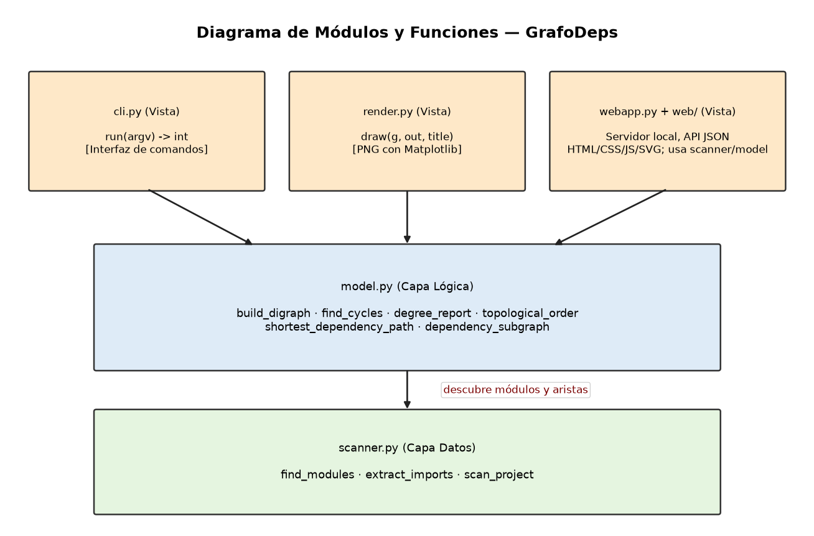

GrafoDeps: Analizador de Dependencias entre Módulos Python con Grafos Dirigidos
Proyecto de Aula — Asignatura Matemáticas Discretas, Grupo A
Universidad de Santander – UDES · Programa de Ingeniería de Software · Semestre B-2026
Docente: Caterine Díaz
Estudiante: Juan Diego Reyes Contreras · Código: 01261152011 · Rol: Product Owner, Scrum Master y Desarrollador
Fecha de entrega: 10 de noviembre de 2026

# 1. Resumen

Las importaciones entre módulos Python pueden formar ciclos que dificultan comprender y mantener un proyecto. GrafoDeps es un prototipo académico que representa las importaciones internas estáticas como un digrafo G = (V, E). Su escáner analiza archivos mediante el árbol de sintaxis abstracta de Python sin ejecutar el código analizado; la capa lógica usa NetworkX para enumerar ciclos, calcular valencias, obtener órdenes topológicos y caminos, y aislar dependencias transitivas. Los resultados se consultan desde la CLI o desde un explorador web local implementado con la biblioteca estándar de Python y JavaScript, HTML y SVG nativos; ambas interfaces permiten exportar el grafo a PNG. La suite final contiene 25 pruebas automatizadas. En un benchmark de 50 módulos de código más un `__init__.py` (51 vértices, 144 aristas), el promedio de cinco ejecuciones del escaneo y análisis del grafo fue de 0.0174 segundos y la mayor corrida tomó 0.0387 segundos, ambos por debajo del límite de 5 segundos. El análisis no cubre importaciones dinámicas ni permite concluir por sí solo sobre la calidad global de un sistema de software.

Palabras clave: grafos dirigidos, dependencias circulares, ingeniería de software, Python, NetworkX

# 2. Introducción

En proyectos de Python, las importaciones entre módulos pueden formar ciclos cuando un módulo importa, directa o indirectamente, a otro que depende de él. Según el orden de inicialización y los símbolos utilizados, algunos ciclos pueden causar errores como `ImportError` o acceso a módulos parcialmente inicializados; otros pueden no producir un error inmediato. En cualquier caso, la estructura circular puede dificultar la comprensión de dependencias y la planificación de cambios o pruebas.

Para estudiar esta estructura, el presente trabajo aplica conceptos de teoría de grafos discretos al análisis estático de código Python. GrafoDeps representa las importaciones internas que reconoce su escáner como un digrafo y permite consultar ciclos, valencias, caminos y subgrafos. Sus resultados describen el código fuente analizado; no constituyen una evaluación completa de la salud arquitectónica del sistema.

El presente documento se encuentra estructurado en catorce secciones que detallan el ciclo de vida del proyecto. En la sección 3 se enuncian los objetivos general y específicos. La sección 4 expone el planteamiento del problema y su justificación práctica, académica y tecnológica. La sección 5 compendia el marco teórico, conceptual y tecnológico. La sección 6 describe el proceso incremental de desarrollo, inspirado en Scrum, y sus fases. La sección 7 delimita el alcance y las restricciones del sistema. La sección 8 detalla los requerimientos funcionales y no funcionales con su correspondiente matriz de trazabilidad. La sección 9 presenta el diseño arquitectónico de tres capas, los diagramas de casos de uso y módulos, y el modelo matemático formal. La sección 10 enumera las herramientas y tecnologías seleccionadas. La sección 11 analiza los beneficios e impacto esperado, complementados con los resultados experimentales de evaluación. La sección 12 formula recomendaciones para versiones futuras. La sección 13 lista las referencias bibliográficas en norma APA 7.ª edición, y la sección 14 reúne los apéndices con fragmentos de código, manual de usuario, casos de prueba y evidencias gráficas de ejecución.

# 3. Objetivos

## 3.1 Objetivo General

Desarrollar y evaluar una herramienta de software en Python que modele las importaciones internas de un proyecto como un grafo dirigido y produzca diagnósticos verificables de sus dependencias.

## 3.2 Objetivos Específicos

1. Definir en el marco teórico cinco conceptos de grafos dirigidos aplicados al problema: valencias, camino, circuito, orden topológico y subgrafo inducido.
2. Especificar el modelo G = (V, E), la arquitectura de tres capas y tres diagramas del sistema.
3. Implementar y probar la extracción de importaciones internas, el cálculo de ciclos, valencias, orden de construcción, caminos, subgrafos y la exportación de grafos a PNG.
4. Evaluar el escaneo y análisis de un proyecto sintético de al menos 50 módulos con cinco mediciones y verificar que cada medición sea inferior a 5 segundos.

# 4. Justificación y Planteamiento del Problema

## 4.1 Planteamiento del Problema

En proyectos de software desarrollados en Python, las importaciones circulares pueden dificultar el diagnóstico de dependencias y, en ciertas condiciones de inicialización, ocasionar errores al importar o acceder a nombres aún no definidos. Su efecto depende de la estructura de los módulos y del momento en que se usan sus símbolos; por ello, no se afirma que todo ciclo produzca un fallo en ejecución.

Esta situación plantea tres dificultades: los ciclos impiden obtener un orden topológico global del digrafo; las dependencias entre módulos pueden aumentar el alcance de ciertos cambios; y la falta de visibilidad sobre esas relaciones puede dificultar la planificación de pruebas y refactorizaciones. GrafoDeps aborda únicamente la visualización y consulta de las importaciones estáticas internas que alcanza a resolver.

## 4.2 Justificación

La justificación de GrafoDeps se sustenta en tres perspectivas complementarias:

**Práctica**: GrafoDeps ofrece un prototipo de consola que inspecciona el árbol de código, enumera los ciclos encontrados y genera un gráfico que resalta los módulos implicados. Esto puede apoyar la revisión y depuración manual de dependencias.

**Académica**: El proyecto articula de forma rigurosa los conceptos formales de la asignatura Matemáticas Discretas (impartida por la docente Caterine Díaz) con los desafíos reales de la Ingeniería de Software. Conceptos como relaciones binarias homogéneas, grafos dirigidos, grados de entrada y salida, componentes fuertemente conexas, circuitos simples y ordenamientos topológicos dejan de ser abstracciones de pizarrón para convertirse en el motor algorítmico de una solución de ingeniería.

**Tecnológica**: Se utiliza el módulo estándar `ast` para analizar la sintaxis sin ejecutar el código fuente, junto con NetworkX para operar sobre grafos y Matplotlib para generar imágenes. El prototipo se limita a las formas de importación estáticas que resuelve su escáner.

# 5. Marco de Referencia

## 5.1 Marco Teórico

El soporte matemático de GrafoDeps proviene de la teoría de grafos y relaciones binarias en estructuras discretas (Rosen, 2019; Johnsonbaugh, 2005; Díaz, 2026).

Formalmente, un grafo dirigido o digrafo es un par ordenado G = (V, E), donde V = {v₁, v₂, ..., vₙ} es un conjunto finito no vacío cuyos elementos se denominan vértices o nodos, y E ⊆ V × V es un conjunto de pares ordenados (u, v) denominados aristas dirigidas o arcos. La presencia de (u, v) ∈ E denota una relación dirigida con origen en u y destino en v; en nuestro contexto, indica que el módulo u importa e invoca elementos del módulo v. Un arco de la forma (u, u) representa un lazo o bucle, correspondiente a una autoimportación.

Para cada vértice v ∈ V, se definen dos métricas fundamentales de valencia o grado:
- Valencia de entrada δₑ(v): número de aristas que inciden en v, es decir, cantidad de módulos que importan a v (fan-in).
- Valencia de salida δₛ(v): número de aristas que emergen de v, es decir, cantidad de módulos que v importa (fan-out).

Por el primer teorema de la teoría de grafos aplicado a digrafos (identidad de la suma de grados), se verifica de manera estricta que:
Σ_{v ∈ V} δₑ(v) = Σ_{v ∈ V} δₛ(v) = |E|

Un recorrido dirigido de longitud k desde un vértice v₀ hasta vₖ es una secuencia v₀, v₁, ..., vₖ tal que (vᵢ₋₁, vᵢ) ∈ E para todo 1 ≤ i ≤ k. Es un camino simple cuando todos sus vértices son distintos. Un circuito es un recorrido cerrado, v₀ = vₖ, de longitud k ≥ 1; es simple o elemental cuando no repite vértices salvo el primero y el último. Johnson (1975) propuso un algoritmo para enumerar los circuitos simples de un digrafo con tiempo O((|V| + |E|)(c + 1)), donde c es el número de circuitos enumerados.

Un digrafo es fuertemente conexo si existe un camino orientado entre cualquier par de vértices. Las componentes fuertemente conexas (CFC) corresponden a subgrafos inducidos maximales que satisfacen dicha propiedad; cualquier componente fuertemente conexa con más de un vértice representa un clúster de módulos con dependencia mutua cíclica.

Un grafo dirigido acíclico (DAG, por sus siglas en inglés) carece de circuitos dirigidos. Un digrafo admite un orden topológico —una permutación lineal en la que, para cada arco (u, v), u precede a v— si y solo si es acíclico (Rosen, 2019). Aquí los arcos van del módulo que importa al módulo importado; por ello, el orden de construcción con dependencias primero es el inverso de un orden topológico. `model.topological_order` devuelve el orden topológico formal y la CLI invierte esa lista para presentar el orden de construcción.

## 5.2 Marco Conceptual

| Término | Definición |
|---|---|
| Módulo | Archivo individual con extensión `.py` que agrupa funciones, clases y variables lógicamente relacionadas. |
| Paquete | Directorio que contiene un archivo `__init__.py` y agrupa múltiples módulos o subpaquetes en un espacio de nombres. |
| Importación | Mecanismo sintáctico de Python mediante el cual un módulo solicita acceso a los símbolos declarados en otro módulo. |
| Dependencia | Relación direccional en la que el funcionamiento de un componente depende de la existencia y validez de otro componente. |
| Dependencia circular | Relación en la que dos o más módulos dependen recíprocamente, directa o indirectamente, formando un ciclo cerrado. |
| Acoplamiento | Medida del grado de interdependencia entre módulos de software; un alto acoplamiento reduce la reusabilidad. |
| Cohesión | Grado en que las responsabilidades internas de un módulo están estrechamente enfocadas a un único propósito. |
| Análisis estático | Técnica de inspección del código fuente realizada sin requerir la compilación ni ejecución del programa. |
| Árbol de sintaxis abstracta (AST) | Representación jerárquica en forma de árbol de la estructura sintáctica de un código fuente según la gramática del lenguaje. |
| Grafo dirigido | Estructura matemática compuesta por un conjunto de nodos y un conjunto de aristas orientadas entre ellos. |
| Vértice | Elemento discreto que representa una entidad en un grafo; en GrafoDeps corresponde a un módulo Python. |
| Arista dirigida | Enlace orientado (u, v) que representa la relación de dependencia donde el módulo u importa al módulo v. |
| Valencia de entrada (δₑ) | Cantidad de aristas que ingresan a un vértice; refleja cuántos otros módulos dependen de él (fan-in). |
| Valencia de salida (δₛ) | Cantidad de aristas que salen de un vértice; refleja de cuántos módulos depende él directamente (fan-out). |
| Circuito simple (Ciclo) | Trayectoria cerrada no vacía en la cual no se repiten vértices intermedios, revelando un bucle de dependencia. |
| Orden topológico | Ordenamiento lineal de los vértices de un DAG en el que, para cada arco (u, v), u aparece antes que v. En GrafoDeps, como el arco va del importador al importado, el orden de construcción con dependencias primero es el inverso de este orden. |
| Subgrafo inducido | Subconjunto de vértices de un grafo junto con todas las aristas cuyos extremos pertenecen a dicho subconjunto. |
| Requerimiento funcional | Declaración explícita de un servicio, comportamiento o cálculo que el sistema de software debe realizar. |
| Arquitectura de tres capas | Patrón de diseño que desacopla la aplicación en componentes de datos, lógica de negocio y presentación o vista. |
| Prueba unitaria | Prueba automatizada diseñada para verificar de manera aislada la corrección lógica de una función o unidad de software. |

## 5.3 Marco Tecnológico

Las tecnologías empleadas en la construcción de GrafoDeps se seleccionaron por su disponibilidad y adecuación al prototipo:

- **Python (versión 3.12.14)**: Lenguaje de programación principal, tipado dinámico con soporte de anotaciones de tipos estáticos (`X | None`). Se eligió por su disponibilidad y por incorporar herramientas internas de inspección de código. La compatibilidad comprobada se limita a los entornos registrados en la matriz de RNF-02.
- **Módulo estándar ast**: Analizador sintáctico integrado en la biblioteca estándar de Python (Python Software Foundation, s. f.). Convierte archivos de código en árboles sintácticos abstractos sin ejecutar las sentencias del proyecto analizado.
- **NetworkX (versión 3.7)**: Biblioteca para la creación y el análisis de grafos (Hagberg et al., 2008). Se usa para manipular digrafos, enumerar ciclos, verificar DAGs y calcular componentes fuertemente conexas.
- **Matplotlib (versión 3.11.2)**: Librería para generación de visualizaciones estáticas en 2D (Hunter, 2007). Se configuró con el backend no interactivo `Agg` para dibujar el digrafo y exportarlo como imagen rasterizada PNG sin depender de servidores gráficos o pantallas físicas; la disposición de nodos se calcula con `spring_layout` de NetworkX.
- **Python-docx (versión 1.2.0)**: Biblioteca para la creación y manipulación programática de documentos en formato Microsoft Word (`.docx`). Permite ensamblar automáticamente informes técnicos con tablas tipografiadas e imágenes incrustadas.
- **Pytest (versión 9.2.0)**: Framework estándar de pruebas automatizadas en Python. Facilita la adopción de desarrollo guiado por pruebas (TDD) mediante aserciones claras y captura de salidas en consola.
- **Git**: Sistema de control de versiones distribuido utilizado para mantener un historial trazable de cambios organizados en commits atómicos por funcionalidad.

# 6. Marco Metodológico — Metodología del Desarrollo

El desarrollo siguió un proceso incremental inspirado en Scrum (Schwaber & Sutherland, 2020), adecuado al alcance individual del proyecto. Se organizaron entregables por fases y se refinaron casos límite mediante pruebas automatizadas (TDD), en especial para las diferencias entre importaciones absolutas, relativas y paquetes internos. No se afirma la ejecución de todas las ceremonias ni de la estructura de equipo de Scrum.

El estudiante Juan Diego Reyes Contreras realizó individualmente las tareas de definición de requerimientos, organización del trabajo, diseño e implementación del código, pruebas e informe. Estas tareas se relacionan con responsabilidades que Scrum asigna a distintos roles, pero no implican que hubiera un equipo con roles separados. La especificación de requerimientos tomó como referencia IEEE Std 830-1998 (IEEE, 1998).

La clasificación metodológica del proyecto corresponde a:
- **Tipo de investigación**: Aplicada y descriptiva, con medición cuantitativa del tiempo de análisis y registro de resultados de pruebas. No se calculó cobertura de código.
- **Técnicas de recolección de información**: Revisión bibliográfica de textos y documentación técnica citados en la sección 13; experimentación con una estructura sintética generada por el benchmark y con el ejemplo `tienda`; observación del autoanálisis del repositorio. El proyecto `tienda` y el benchmark son casos de prueba, no proyectos industriales.

El desarrollo inicial se organizó en tres fases; posteriormente se incorporó una ampliación local para facilitar la exploración visual durante la demostración.

| Fase | Periodo aproximado | Entregable |
|---|---|---|
| Sprint 1 — Investigación y modelo | 5 al 6 de noviembre de 2026 | Marco teórico matemático, formulación del modelo G = (V, E) y diseño arquitectónico en 3 capas. |
| Sprint 2 — Implementación | 7 al 8 de noviembre de 2026 | Módulos `scanner.py`, `model.py`, conjunto de pruebas unitarias en `pytest` y validación de ciclos. |
| Sprint 3 — Interfaz, evaluación e informe | 9 de noviembre de 2026 | Módulos `cli.py` y `render.py`, benchmark RNF-01, diagramas, generador `.docx` e informe final. |
| Ampliación — Explorador web local | 10 de noviembre de 2026 | `webapp.py`, recursos HTML/CSS/JavaScript/SVG, pruebas de integración y validación de interacciones en navegador. |

# 7. Alcance del Proyecto

El alcance de GrafoDeps define con claridad las capacidades suministradas y establece límites operativos transparentes para asegurar la confiabilidad del sistema:

**Funcionalidades incluidas:**
- Análisis estático de proyectos Python locales almacenados en el sistema de archivos del usuario.
- Identificación y extracción de importaciones absolutas (`import paquete.modulo`), sentencias de importación parcial (`from paquete import modulo`) e importaciones relativas con sintaxis de puntos (`from . import modulo`, `from ..sub import modulo`).
- Construcción y manipulación en memoria del grafo dirigido correspondiente G = (V, E).
- Detección exhaustiva de circuitos dirigidos simples y enumeración ordenada de dependencias circulares.
- Cálculo de valencias de entrada δₑ y de salida δₛ para cada módulo detectado.
- Determinación del orden topológico de construcción (dependencias base primero) o emisión de alerta en presencia de ciclos.
- Identificación del camino más corto de dependencia entre dos módulos mediante búsqueda en anchura (BFS).
- Generación de subgrafos inducidos para aislar las dependencias transitivas de un módulo raíz específico.
- Renderizado de diagramas de grafos en formato PNG resaltando los nodos participantes en ciclos en color rojo.
- Explorador web local para cargar una carpeta Python, buscar y seleccionar módulos, resaltar dependencias y ciclos, consultar valencias y exportar el grafo a PNG. El servidor escucha únicamente en loopback.
- Verificación de rendimiento frente a proyectos sintéticos de más de 50 módulos.

**Usuarios destinatarios:**
- Estudiantes de ingeniería de software, arquitectura de sistemas y ciencias de la computación que requieran comprender la estructura modular de sus proyectos.
- Desarrolladores independientes y docentes que precisen una herramienta de diagnóstico desde la CLI o una interfaz web ejecutada localmente.

**Limitaciones y lo que NO incluye el proyecto:**
- NO incluye soporte para proyectos desarrollados en otros lenguajes de programación como Java, JavaScript, TypeScript, C++ o C#.
- NO incluye análisis de librerías externas o paquetes instalados por terceros (`pip`, biblioteca estándar); las llamadas a paquetes externos se descartan intencionalmente para focalizar el análisis en la arquitectura interna.
- NO incluye resolución de importaciones dinámicas realizadas en tiempo de ejecución mediante funciones como `__import__()`, `importlib.import_module()` o construcciones condicionales dinámicas complejas.
- NO incluye una aplicación de escritorio ni un servicio web remoto: la interfaz web se ejecuta en el equipo del usuario y no despliega el analizador en la nube.
- NO incluye almacenamiento persistente en bases de datos ni despliegues en infraestructura de nube.
- **Restricción de diseño:** La carpeta raíz debe ser el directorio del proyecto que contiene los paquetes fuente. Si existe un directorio `src/` con archivos Python, se analiza su contenido y los nombres de módulos se expresan relativos a ese directorio. Si se pasa un subpaquete interno como raíz, las sentencias absolutas que referencien al paquete padre no podrán resolverse como módulos internos. El análisis es estático y no resuelve importaciones creadas dinámicamente ni todos los efectos de ejecución condicional.

# 8. Requerimientos del Sistema

La especificación de requerimientos sigue las directrices del estándar IEEE Std 830-1998 (IEEE, 1998), empleando la palabra «debe» para obligaciones estrictas y «debería» para comportamientos deseables opcionales.

## 8.1 Requerimientos Funcionales (RF)

| ID | Requerimiento |
|---|---|
| RF-01 | El sistema debe permitir indicar la carpeta raíz de un proyecto Python desde la línea de comandos o el formulario del explorador web local. |
| RF-02 | El sistema debe identificar automáticamente los módulos (.py) y paquetes (`__init__.py`) bajo la raíz del proyecto, ignorando carpetas ocultas y `__pycache__`; si existe `src/`, analiza su contenido. |
| RF-03 | El sistema debe extraer las importaciones internas (absolutas, `from x import y` y relativas) mediante análisis sintáctico, ignorando librerías externas y autoimportaciones. |
| RF-04 | El sistema debe construir el grafo dirigido G = (V, E) donde V son los módulos y E las importaciones. |
| RF-05 | El sistema debe detectar y listar todas las dependencias circulares (circuitos simples). |
| RF-06 | El sistema debe calcular y mostrar la valencia de entrada y de salida de cada módulo. |
| RF-07 | El sistema debe calcular el orden topológico y presentar su inverso como orden de construcción (dependencias primero), o informar que no existe cuando hay ciclos. |
| RF-08 | El sistema debe permitir consultar el camino más corto de dependencia entre dos módulos. |
| RF-09 | El sistema debe restringir el reporte y, si se solicita, el grafo exportado al subgrafo de dependencias transitivas de un módulo. |
| RF-10 | El sistema debe generar una imagen PNG del grafo resaltando los módulos que participan en ciclos. |
| RF-11 | El sistema debe informar con un mensaje claro y un código de salida distinto cuando la carpeta no contiene módulos (1), el módulo pedido con `--from` no existe (2) o un archivo tiene errores de sintaxis (3). |
| RF-12 | El explorador web local debe permitir buscar y seleccionar módulos, resaltar sus dependencias transitivas o un ciclo seleccionado, mostrar valencias y exportar la vista actual a PNG. |

## 8.2 Requerimientos No Funcionales (RNF)

| ID | Requerimiento |
|---|---|
| RNF-01 | El sistema debe analizar un proyecto de 50 módulos en menos de 5 segundos. |
| RNF-02 | El sistema debe funcionar en Windows 10/11 y Linux con Python 3.10 o superior. |
| RNF-03 | La ayuda en línea (`--help`) debe estar en español y permitir usar las funciones básicas sin manual. |
| RNF-04 | El código debe separarse en tres capas (datos, lógica, vista) y cada requerimiento funcional debe tener al menos una prueba automatizada. |
| RNF-05 | La ejecución del analizador debe requerir únicamente NetworkX y Matplotlib, además de la biblioteca estándar de Python. `python-docx` y `pytest` se reservan para generar el informe y ejecutar pruebas. |
| RNF-06 | Para la misma entrada, el reporte y la imagen deben ser idénticos entre ejecuciones (diseño determinista). |

### Matriz de Trazabilidad Requerimientos vs. Pruebas Automatizadas

La matriz distingue las verificaciones automatizadas de las revisiones que requieren un entorno o inspección adicional. La prueba de rendimiento mide el análisis del grafo, no la generación de imágenes.

| Requerimiento | Función de prueba automatizada en `tests/` | Archivo |
|---|---|---|
| RF-01, RF-04, RF-11 | `test_cli_end_to_end`, `test_cli_errors`, `test_cli_reports_syntax_error` | `test_render_cli.py` |
| RF-02 | `test_find_modules_names`, `test_find_modules_ignores_hidden_directories_and_pycache` | `test_scanner.py` |
| RF-03 | `test_edges_ignore_external_libs_and_resolve_relative`, `test_relative_import_beyond_package_root_is_ignored`, `test_python_source_encoding_cookie_is_respected`, `test_src_layout_resolves_package_imports_from_project_root`, `test_syntax_error_is_reported` | `test_scanner.py` |
| RF-05 | `test_cycle_detected` | `test_model.py` |
| RF-06 | `test_degrees_sum_equals_edge_count` | `test_model.py` |
| RF-07 | `test_topological_order_none_when_cyclic_and_valid_when_acyclic` | `test_model.py` |
| RF-08 | `test_shortest_path_and_subgraph` | `test_model.py` |
| RF-09 | `test_shortest_path_and_subgraph`, `test_cli_from_restricts_report_to_transitive_dependencies` | `test_model.py`, `test_render_cli.py` |
| RF-10 | `test_draw_writes_deterministic_png_and_highlights_cycles` | `test_render_cli.py` |
| RF-12 | `test_build_payload_exposes_graph_cycles_and_degrees`, `test_local_server_serves_ui_and_analyzes_selected_project`, `test_api_rejects_missing_project_with_structured_error`, `test_server_rejects_requests_with_untrusted_host_header`; interacciones y exportación verificadas manualmente en navegador | `test_webapp.py` y validación manual |
| RNF-01 | `test_rnf01_50_modules_under_5_seconds` (cinco corridas, máximo < 5 s) | `test_performance.py` |
| RNF-03 | `test_cli_help_is_in_spanish` | `test_render_cli.py` |
| RNF-06 | `test_draw_writes_deterministic_png_and_highlights_cycles` | `test_render_cli.py` |
| RNF-02 | Verificado en Windows con Python 3.12.14; pendiente de verificar en Linux y en la versión mínima Python 3.10 | Revisión manual |
| RNF-04 | Inspección de `scanner`/`model` y de las vistas `cli`/`render`/`webapp` + recursos web, además de pruebas funcionales de los RF | Revisión manual y suite `tests/` |
| RNF-05 | Inspección de imports del paquete de ejecución; NetworkX y Matplotlib son sus dependencias externas | Revisión manual |

RNF-02 cuenta con verificación parcial: las pruebas se ejecutaron en Windows con Python 3.12.14; Linux y Python 3.10 no se probaron, por lo que la compatibilidad con esos entornos no se afirma como resultado. RNF-05 se verificó mediante inspección de las importaciones del paquete: la ruta de análisis requiere NetworkX y Matplotlib además de la biblioteca estándar; `python-docx` y `pytest` se usan para generar el informe y ejecutar pruebas, respectivamente.

# 9. Diseño del Sistema

Para el diseño de GrafoDeps se utilizó la distinción entre arquitectura y estructura modular descrita por Sommerville (2015): la arquitectura representa la organización general y los flujos entre componentes, mientras que la estructura modular detalla sus partes e interacciones.

## 9.1 Arquitectura del Sistema

El software adopta el patrón arquitectónico de tres capas desacopladas:
1. **Capa de Datos (`scanner.py`)**: Responsable de interactuar con el sistema de archivos local, descubrir módulos `.py`, parsear su contenido mediante el árbol sintáctico `ast` y extraer aristas de importación interna.
2. **Capa de Lógica (`model.py`)**: Núcleo computacional. Recibe los vértices y aristas para instanciar el digrafo y ejecutar algoritmos de ciclos, grados, orden topológico, caminos y subgrafos.
3. **Capa de Vista (`cli.py`, `render.py`, `webapp.py`, `grafodeps/web/`)**: Gestiona la interacción por CLI y por un servidor HTTP local de la biblioteca estándar. El explorador web consume el mismo escáner y modelo, dibuja el grafo con SVG y JavaScript nativos y permite exportar una imagen PNG; no requiere servicios remotos ni bibliotecas web de terceros.


## 9.2 Casos de Uso

El sistema ofrece una interacción directa orientada al desarrollador de software. A continuación se sintetizan los casos de uso principales:


| Código | Caso de Uso | Descripción |
|---|---|---|
| CU-01 | Cargar proyecto Python | El usuario indica la ruta del proyecto; el escáner identifica módulos y construye el modelo. |
| CU-02 | Ver grafo de dependencias | Muestra el resumen de módulos card(V) y dependencias card(E) por CLI o navegador y permite exportar el gráfico PNG. |
| CU-03 | Detectar ciclos | Ejecuta el algoritmo de Johnson e imprime la lista de circuitos de importación circular. |
| CU-04 | Consultar valencias | Muestra el reporte detallado de grado de entrada δₑ y salida δₛ por cada módulo. |
| CU-05 | Obtener orden de construcción | Genera la lista ordenada de carga o reporta la imposibilidad ante ciclos presentes. |
| CU-06 | Buscar camino entre módulos | Calcula e imprime la ruta directa de dependencias desde un módulo origen hacia un destino. |
| CU-07 | Ver subgrafo de un módulo | Aísla y analiza el subgrafo formado por un módulo y todas sus dependencias transitivas. |
| CU-08 | Explorar el grafo en el navegador | Carga una ruta local, permite buscar y seleccionar módulos o ciclos, muestra relaciones y valencias y exporta la visualización a PNG. |

## 9.3 Estructura de Módulos y Funciones

La organización interna de paquetes y funciones principales se presenta a continuación:



- `grafodeps.scanner`:
  - `find_modules(root) -> dict[str, Path]`: Escanea recursivamente el árbol de archivos.
  - `extract_imports(file, current, known) -> set[str]`: Extrae dependencias internas mediante `ast`.
  - `scan_project(root) -> tuple[list[str], list[tuple[str, str]]]`: Punto de integración de datos.
- `grafodeps.model`:
  - `build_digraph(modules, edges) -> nx.DiGraph`: Construye la instancia del modelo matemático.
  - `find_cycles(g) -> list[list[str]]`: Detección normalizada de circuitos simples.
  - `degree_report(g) -> dict[str, dict[str, int]]`: Cálculo de grados δₑ y δₛ.
  - `topological_order(g) -> list[str] | None`: Orden topológico formal; `None` si el grafo contiene ciclos.
  - `shortest_dependency_path(g, src, dst) -> list[str] | None`: Búsqueda de rutas de impacto.
  - `dependency_subgraph(g, root) -> nx.DiGraph`: Extracción de subgrafo inducido transitivo.
  - `strongly_connected_groups(g) -> list[list[str]]`: Agrupaciones fuertemente conexas.
- `grafodeps.render`:
  - `draw(g, out, title) -> None`: Renderiza el gráfico en PNG usando layout elástico `spring_layout`.
- `grafodeps.cli`:
  - `run(argv) -> int`: Orquestador de interfaz por línea de comandos.
- `grafodeps.webapp` y `grafodeps/web/`:
  - Servidor HTTP local enlazado a loopback, endpoint JSON de análisis y recursos estáticos HTML, CSS y JavaScript.
  - La interfaz presenta el mismo modelo del proyecto, destaca dependencias/ciclos y genera la descarga PNG en el navegador.

## 9.4 Modelo Matemático Formal

El proyecto se representa como un grafo dirigido G = (V, E), donde V = {m₁, …, mₙ} es el conjunto de módulos Python y E ⊆ V×V es la relación de importación: (a, b) ∈ E si y solo si el módulo a importa al módulo b. Un ciclo de dependencia es un circuito simple de G. G admite orden topológico y, por tanto, un orden de construcción sin ciclos si y solo si es acíclico. Como la dirección del arco es importador → importado, el orden de construcción es el inverso del orden topológico formal.

Sean n = |V|, m = |E|, c el número de ciclos simples enumerados, y K el tamaño total de los archivos fuente. La tabla separa tiempo y espacio adicional; el espacio de salida se señala cuando crece con los resultados.

| Operación | Función en código | Tiempo | Espacio adicional / salida |
|---|---|---|---|
| Escaneo y extracción de imports | `scanner.scan_project` | O(K) esperado, además del recorrido del sistema de archivos | O(n + m), para módulos y aristas |
| Enumeración de ciclos simples | `model.find_cycles` | O((n + m)(c + 1)) | O(n + m) auxiliar; O(nc) para almacenar la salida en el peor caso |
| Orden topológico lexicográfico | `model.topological_order` | O(n log n + m) | O(n) auxiliar y para el orden devuelto |
| Camino más corto (BFS) | `model.shortest_dependency_path` | O(n + m) | O(n) auxiliar y para el camino |
| Dependencias transitivas y subgrafo inducido | `model.dependency_subgraph` | O(n + m) | O(n + m) para el subgrafo devuelto |

### Ejemplo Numérico Demostrativo (Proyecto `tienda`)

Para validar empíricamente el modelo matemático, se analizó el proyecto de prueba `examples/tienda`, compuesto por 8 módulos y 8 aristas de importación:
- Vértices |V| = 8: `tienda`, `tienda.carrito`, `tienda.impuestos`, `tienda.inventario`, `tienda.main`, `tienda.notificaciones`, `tienda.precios`, `tienda.usuarios`.
- Aristas |E| = 8 dirigidas.
- Valencias reales:
  - `tienda.main`: δₑ = 0, δₛ = 2 (depende de carrito y usuarios).
  - `tienda.carrito`: δₑ = 1, δₛ = 2 (depende de precios e inventario).
  - `tienda.precios`: δₑ = 2, δₛ = 1 (depende de impuestos; importado por carrito e impuestos).
  - `tienda.impuestos`: δₑ = 1, δₛ = 1 (depende de precios; importado por precios).
  - `tienda.notificaciones`: δₑ = 2, δₛ = 0 (módulo base terminal).
  - Suma de valencias: Σ δₑ = Σ δₛ = 8 = |E|.
- Circuito detectado: `tienda.impuestos -> tienda.precios -> tienda.impuestos` (ciclo simple de longitud 2).
- Veredicto de orden topológico: no existe ordenamiento válido debido a la presencia del circuito.
- Camino más corto de `tienda.main` a `tienda.impuestos`: `tienda.main -> tienda.carrito -> tienda.precios -> tienda.impuestos` (longitud 3).

# 10. Herramientas y Tecnología

La implementación de GrafoDeps se organizó en cuatro categorías tecnológicas:

- **Lenguaje de programación**:
  - Python 3.12.14: Seleccionado por su disponibilidad y por incorporar el módulo `ast` (Python Software Foundation, s. f.) para analizar sintaxis sin ejecutar el código. La compatibilidad comprobada se limita a los entornos indicados en la matriz de RNF-02.
- **Frameworks y librerías**:
  - NetworkX 3.7: Librería para análisis y representación de estructuras de grafos (Hagberg et al., 2008). Se eligió por contar con algoritmos optimizados para digrafos, búsqueda de ciclos elementales y orden topológico.
  - Matplotlib 3.11.2: Librería gráfica (Hunter, 2007) utilizada para dibujar el digrafo y exportar imágenes rasterizadas PNG; la disposición de nodos se calcula con `spring_layout` de NetworkX.
  - Biblioteca estándar de Python (`http.server`): Sirve el explorador y el endpoint JSON únicamente en loopback, sin añadir un framework web de terceros. La interfaz utiliza HTML, CSS, JavaScript y SVG nativos del navegador.
  - Python-docx 1.2.0: Utilizada para compilar automáticamente el informe formal a formato estándar Microsoft Word.
  - Pytest 9.2.0: Framework empleado para el desarrollo guiado por pruebas (TDD) y validación de regresiones.
- **Herramientas de desarrollo**:
  - Git: Control de versiones distribuido para la trazabilidad y preservación de cambios en commits atómicos.
  - Visual Studio Code y Terminal PowerShell: Entorno de edición y ejecución en sistema operativo Windows con soporte UTF-8.
  - Entorno virtual (`uv venv`): Aislamiento hermético de dependencias de software sin interferir con paquetes del sistema.
- **Herramientas de diseño**:
  - Script programático reproducible `make_diagrams.py`: Utilizó Matplotlib para sintetizar los diagramas arquitectónicos y de casos de uso con exactitud geométrica, garantizando regeneración automática ante cambios de diseño. Como alternativa visual manual se consideró draw.io.

# 11. Beneficios e Impacto Esperado

Como prototipo, GrafoDeps puede aportar beneficios en cuatro dimensiones; no se realizó un estudio para cuantificar ahorros o impacto industrial:

- **Beneficios técnicos**: Puede ayudar a detectar ciclos de importación durante una revisión de código y orientar la refactorización antes del despliegue.
- **Beneficios académicos**: Permite a estudiantes y docentes visualizar de manera tangible cómo nociones matemáticas abstractas (valencias, caminos, componentes conexas, DAGs) resuelven problemas concretos de diseño de software.
- **Beneficios para el usuario**: Entrega diagnósticos por línea de comandos o mediante una visualización en el navegador; la vista web requiere iniciar el servidor local y no necesita bases de datos, cuentas ni servicios externos.
- **Beneficios para la industria**: Ofrece un ejemplo de análisis estático que podría adaptarse a proyectos reales, sujeto a validar su precisión y utilidad en esos contextos.

## 11.1 Resultados de la Evaluación Experimental

La evaluación se limita a las pruebas automatizadas y a los casos de prueba descritos en `evidencias.txt`:
- **Correctitud funcional**: La suite automatizada final reportó **25 pruebas aprobadas**. Esto es una tasa de aprobación de pruebas, no una medición de cobertura de código. La página, la API y el contrato de errores tienen pruebas de integración; las interacciones y la exportación PNG también se validaron manualmente en un navegador.
- **Rendimiento algorítmico (RNF-01)**: El benchmark generó 50 módulos de código y un `__init__.py` (51 vértices en total) con 144 aristas. En cinco corridas, el promedio fue de **0.0174 s** y el máximo de **0.0387 s**, por debajo del límite de 5 s. Se midió escaneo, construcción del digrafo y algoritmos de ciclos y orden topológico; se excluyó la generación de imágenes.
- **Proyecto de prueba `tienda`**: Identificó con exactitud el ciclo elemental `tienda.impuestos ⇄ tienda.precios`, diagnosticó la ausencia de orden topológico y trazó la ruta `main -> carrito -> precios -> impuestos`.
- **Autoanálisis del repositorio**: El escáner identificó 28 módulos y 19 aristas internas, incluyendo el servidor web y sus pruebas, código, ejemplos y herramientas de documentación; no encontró ciclos. Para que la visualización sea legible, la Figura 5 muestra únicamente el paquete principal `grafodeps`: seis módulos y seis dependencias internas. El análisis amplio y la figura enfocada tienen alcances distintos; ninguno constituye por sí solo una certificación de calidad o modularidad.

# 12. Recomendaciones para Versiones Futuras

A partir de los aprendizajes derivados de la construcción del prototipo, se plantean las siguientes recomendaciones:

1. **Soporte multilinguaje**: Extender el escáner sintáctico para analizar dependencias en proyectos Java (mediante análisis de bytecode o AST de Eclipse JDT) y JavaScript/TypeScript (mediante parsers Babel o SWC).
2. **Ampliación de la visualización web**: Incorporar zoom y desplazamiento del lienzo, filtrado visual directo de nodos y reorganización interactiva; el prototipo actual permite buscar módulos y resaltar dependencias, pero no ofrece esos controles.
3. **Métricas de calidad de software**: Incorporar cálculos de inestabilidad de Robert C. Martin (I = Ce / (Ca + Ce)), métricas de fan-in/fan-out normalizadas y condensación de componentes fuertemente conexas en supernodos.
4. **Integración continua (CI/CD)**: Empaquetar la herramienta como una acción de GitHub Actions o pre-commit hook que bloquee el merge de pull requests si se introducen nuevos ciclos de importación.
5. **Detección de dependencias dinámicas**: Investigar técnicas de análisis híbrido (análisis dinámico ligero con rastreo de sys.modules) para complementar la detección de importaciones generadas por `importlib`.
6. **Optimización para grafos hiperdensos**: Limitar la profundidad de búsqueda o el número máximo de ciclos reportados en grafos con alta densidad de aristas, previniendo la explosión combinatoria propia del peor caso del algoritmo de Johnson.

# 13. Referencias Bibliográficas

Díaz, C. (2026). *Guía sobre teoría de grafos* [Material de clase]. Universidad de Santander (UDES), Programa de Ingeniería de Software.

Hagberg, A. A., Schult, D. A., & Swart, P. J. (2008). Exploring network structure, dynamics, and function using NetworkX. En G. Varoquaux, T. Vaught, & J. Millman (Eds.), *Proceedings of the 7th Python in Science Conference* (pp. 11–15). https://doi.org/10.25080/tcwv9851

Hunter, J. D. (2007). Matplotlib: A 2D graphics environment. *Computing in Science & Engineering, 9*(3), 90-95. https://doi.org/10.1109/MCSE.2007.55

IEEE. (1998). *IEEE recommended practice for software requirements specifications* (IEEE Std 830-1998). IEEE. https://doi.org/10.1109/IEEESTD.1998.88286

Johnson, D. B. (1975). Finding all the elementary circuits of a directed graph. *SIAM Journal on Computing, 4*(1), 77–84. https://doi.org/10.1137/0204007

Johnsonbaugh, R. (2005). *Matemáticas discretas* (6.ª ed.). Pearson Educación.

Python Software Foundation. (s. f.). *ast — Abstract syntax trees*. Python 3 documentation. https://docs.python.org/3/library/ast.html

Rosen, K. H. (2019). *Discrete mathematics and its applications* (8th ed.). McGraw-Hill Education.

Schwaber, K., & Sutherland, J. (2020). *The Scrum Guide*. https://scrumguides.org

Sommerville, I. (2015). *Software engineering* (10th ed.). Pearson.

# 14. Apéndices

## Apéndice A — Código Fuente Principal

A continuación se transcriben los núcleos algorítmicos implementados en la herramienta.

Fragmento de extracción sintáctica de dependencias (`grafodeps/scanner.py`):
```python
def extract_imports(file: Path, current: str, known: set[str]) -> set[str]:
    """Módulos internos importados por `file`. Ignora librerías externas y autoimportaciones."""
    is_pkg = file.name == "__init__.py"
    package = current if is_pkg else current.rpartition(".")[0]
    deps: set[str] = set()
    with tokenize.open(file) as source:
        tree = ast.parse(source.read(), filename=str(file))
    for node in ast.walk(tree):
        if isinstance(node, ast.Import):
            for alias in node.names:
                hit = _longest_known(alias.name, known)
                if hit:
                    deps.add(hit)
        elif isinstance(node, ast.ImportFrom):
            if node.level:
                base_parts = package.split(".") if package else []
                if node.level > len(base_parts):
                    continue
                base_parts = base_parts[: len(base_parts) - (node.level - 1)] if node.level > 1 else base_parts
                base = ".".join(base_parts + ([node.module] if node.module else []))
            else:
                base = node.module or ""
            for alias in node.names:
                hit = _longest_known(f"{base}.{alias.name}" if base else alias.name, known) \
                    or _longest_known(base, known)
                if hit:
                    deps.add(hit)
    deps.discard(current)
    return deps
```

Fragmento de detección y normalización de circuitos (`grafodeps/model.py`):
```python
def find_cycles(g: nx.DiGraph) -> list[list[str]]:
    """Circuitos simples dirigidos (dependencias circulares), normalizados y ordenados."""
    cycles = []
    for c in nx.simple_cycles(g):
        i = c.index(min(c))
        cycles.append(c[i:] + c[:i])
    return sorted(cycles)
```

## Apéndice B — Manual de Instalación y Uso

**Requisitos previos:**
- Python 3.10 o superior instalado.
- Sistema operativo Windows 10/11 o Linux.

**Instalación:**
1. Clonar o acceder a la carpeta del repositorio `grafodeps`.
2. Crear un entorno virtual e instalar las dependencias:
```bash
python -m venv .venv
# En Windows PowerShell:
.venv\Scripts\Activate.ps1
# En Linux/macOS:
source .venv/bin/activate
pip install -r requirements.txt
```

**Ejemplos de uso:**
- Análisis completo de un proyecto y generación de imagen:
```bash
python -m grafodeps.cli examples --out grafo.png
```
- Consulta del camino de dependencia entre dos módulos:
```bash
python -m grafodeps.cli examples --path tienda.main tienda.impuestos
```
- Análisis enfocado en el subgrafo de dependencias de un módulo:
```bash
python -m grafodeps.cli examples --from tienda.carrito --out subgrafo_carrito.png
```
- Explorador web local (iniciar desde la raíz del repositorio y abrir la URL indicada):
```bash
python -m grafodeps.webapp
```
El servidor escucha en `http://127.0.0.1:8765`; detenerlo con Ctrl+C.

**Códigos de salida del sistema:**
- `0`: Análisis completado exitosamente.
- `1`: No se encontraron archivos de módulo Python en el directorio especificado.
- `2`: El módulo solicitado con el parámetro `--from` no existe en el proyecto.
- `3`: Error de sintaxis (`SyntaxError`) al parsear algún archivo `.py`.

## Apéndice C — Casos de Prueba Automatizados

| Caso de prueba | Función en `tests/` | Entrada | Resultado esperado |
|---|---|---|---|
| Detección de módulos | `test_find_modules_names`, `test_find_modules_ignores_hidden_directories_and_pycache` | Paquete con módulos y carpetas ocultas/de caché | Identifica módulos e ignora directorios ocultos y `__pycache__` |
| Resolución de importaciones | `test_edges_ignore_external_libs_and_resolve_relative`, `test_relative_import_beyond_package_root_is_ignored`, `test_python_source_encoding_cookie_is_respected`, `test_src_layout_resolves_package_imports_from_project_root` | Imports absolutos, relativos, Latin-1 y estructura `src/` | Detecta aristas internas válidas, excluye importación relativa inválida y respeta codificación |
| Detección de errores sintácticos | `test_syntax_error_is_reported` | Archivo con sintaxis inválida `def (:` | Lanza excepción `SyntaxError` controlada |
| Detección de circuitos | `test_cycle_detected` | Proyecto `sample_project` | Detecta ciclo entre `pricing` y `tax` |
| Orden topológico | `test_topological_order_none_when_cyclic_and_valid_when_acyclic` | Digrafo acíclico y cíclico | Retorna None si hay ciclo; orden lineal si es DAG |
| Conservación de valencias | `test_degrees_sum_equals_edge_count` | Proyecto con 6 aristas | Σ δₑ = Σ δₛ = card(E) |
| Camino mínimo y subgrafo | `test_shortest_path_and_subgraph` | Módulos `main` e `impuestos` | Encuentra trayectoria de longitud 3 y subgrafo conexo |
| Exportación y resaltado de imagen | `test_draw_writes_deterministic_png_and_highlights_cycles` | Digrafo de 2 nodos con ciclo | PNG generado, nodos cíclicos en rojo e imagen idéntica en ejecuciones repetidas |
| Ejecución CLI integral | `test_cli_end_to_end` | Argumentos `--out` y `--path` | Retorna código 0 y salida con ciclo detectado |
| Filtrado transitivo en CLI | `test_cli_from_restricts_report_to_transitive_dependencies` | Módulo `shop.cart` | Reporte y camino restringidos a sus dependencias |
| Ayuda en español | `test_cli_help_is_in_spanish` | Argumento `--help` | Ayuda legible en español |
| Reporte determinista | `test_cli_report_is_deterministic` | Mismo proyecto analizado dos veces | Salidas textuales idénticas |
| Códigos de error CLI | `test_cli_errors` | Carpeta vacía y módulo inexistente | Retorna códigos de salida 1 y 2 respectivamente |
| Manejo de error CLI sintáctico | `test_cli_reports_syntax_error` | Carpeta con archivo malformado | Retorna código de salida 3 |
| Rendimiento RNF-01 | `test_rnf01_50_modules_under_5_seconds` | Proyecto con 50 módulos y paquete | Cinco corridas; todas < 5 segundos; 51 vértices y 144 aristas |
| Validación de rúbrica | `test_checker_accepts_valid_and_rejects_broken` | Archivos de informe de prueba | Acepta documento válido y rechaza faltantes |
| Generación de `.docx` | `test_builder_makes_docx` | Markdown con tablas e imágenes | Construye documento Word con tablas e imágenes incrustadas |
| Explorador web local | `test_build_payload_exposes_graph_cycles_and_degrees`, `test_local_server_serves_ui_and_analyzes_selected_project`, `test_api_rejects_missing_project_with_structured_error`, `test_server_rejects_requests_with_untrusted_host_header` | GET de recursos, análisis JSON, ruta inexistente y Host no confiable | Sirve la UI, responde con el grafo y errores estructurados y rechaza el Host no permitido |

## Apéndice D — Capturas y Salidas del Sistema

A continuación se presentan los gráficos generados por la herramienta durante la evaluación experimental.


Registro textual de las evidencias reales obtenidas en consola (`docs/informe/evidencias.txt`):
```text
examples/tienda creado
Módulos |V| = 8   Dependencias |E| = 8
Dependencias circulares: 1
  tienda.impuestos -> tienda.precios -> tienda.impuestos
Orden de construcción: no existe (hay ciclos)
Valencias (entrada/salida):
  tienda: δe=0 δs=0
  tienda.carrito: δe=1 δs=2
  tienda.impuestos: δe=1 δs=1
  tienda.inventario: δe=1 δs=1
  tienda.main: δe=0 δs=2
  tienda.notificaciones: δe=2 δs=0
  tienda.precios: δe=2 δs=1
  tienda.usuarios: δe=1 δs=1
Imagen guardada en docs/informe/img/grafo_demo.png
Módulos |V| = 8   Dependencias |E| = 8
Dependencias circulares: 1
  tienda.impuestos -> tienda.precios -> tienda.impuestos
Orden de construcción: no existe (hay ciclos)
Valencias (entrada/salida):
  tienda: δe=0 δs=0
  tienda.carrito: δe=1 δs=2
  tienda.impuestos: δe=1 δs=1
  tienda.inventario: δe=1 δs=1
  tienda.main: δe=0 δs=2
  tienda.notificaciones: δe=2 δs=0
  tienda.precios: δe=2 δs=1
  tienda.usuarios: δe=1 δs=1
Camino: tienda.main -> tienda.carrito -> tienda.precios -> tienda.impuestos
Módulos |V| = 26   Dependencias |E| = 16
Dependencias circulares: 0
Orden de construcción: grafodeps.scanner , tests.test_scanner , tests.test_report_tools , grafodeps.model , grafodeps.render , grafodeps.cli , tests.test_render_cli , tests.conftest , tests.test_performance , tests.test_model , tests , scripts.make_demo , scripts.benchmark , scripts , grafodeps , examples.tienda.usuarios , examples.tienda.impuestos , examples.tienda.precios , examples.tienda.notificaciones , examples.tienda.main , examples.tienda.inventario , examples.tienda.carrito , examples.tienda , docs.informe.make_diagrams , docs.informe.check_report , docs.informe.build_report
Valencias (entrada/salida):
  docs.informe.build_report: δe=0 δs=0
  docs.informe.check_report: δe=0 δs=0
  docs.informe.make_diagrams: δe=0 δs=0
  examples.tienda: δe=0 δs=0
  examples.tienda.carrito: δe=0 δs=0
  examples.tienda.impuestos: δe=1 δs=0
  examples.tienda.inventario: δe=0 δs=0
  examples.tienda.main: δe=0 δs=0
  examples.tienda.notificaciones: δe=0 δs=0
  examples.tienda.precios: δe=0 δs=1
  examples.tienda.usuarios: δe=0 δs=0
  grafodeps: δe=0 δs=0
  grafodeps.cli: δe=1 δs=3
  grafodeps.model: δe=6 δs=0
  grafodeps.render: δe=2 δs=1
  grafodeps.scanner: δe=5 δs=0
  scripts: δe=0 δs=0
  scripts.benchmark: δe=0 δs=2
  scripts.make_demo: δe=0 δs=0
  tests: δe=0 δs=0
  tests.conftest: δe=1 δs=0
  tests.test_model: δe=0 δs=2
  tests.test_performance: δe=0 δs=3
  tests.test_render_cli: δe=0 δs=3
  tests.test_report_tools: δe=0 δs=0
  tests.test_scanner: δe=0 δs=1
Imagen guardada en docs/informe/img/grafo_autoanalisis.png
Módulos: 51  Aristas: 144
Tiempo medio de 5 corridas: 0.0174 s   (RNF-01: < 5 s)
Tiempo máximo de 5 corridas: 0.0387 s
.....................                                                    [100%]
21 passed in 2.35s
```

## Apéndice E — Glosario de Conceptos

Para la definición exhaustiva y formal de cada uno de los términos de Matemática Discreta e Ingeniería de Software empleados a lo largo del presente informe, consúltese la tabla detallada del Marco Conceptual presentada en la sección 5.2.
