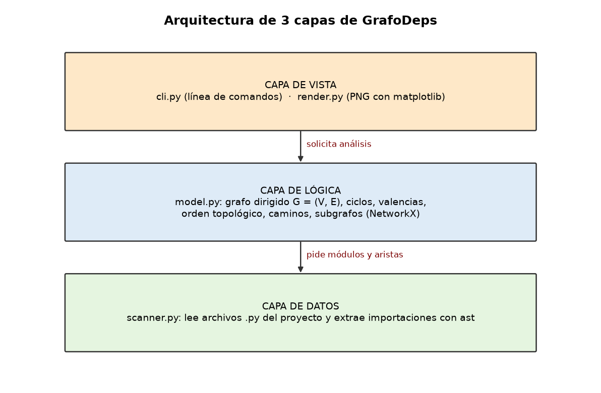
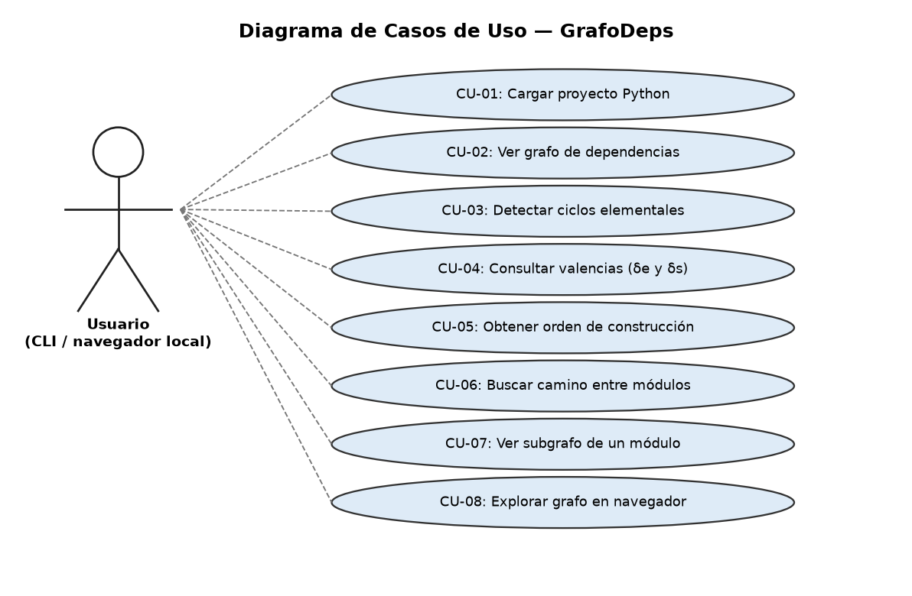
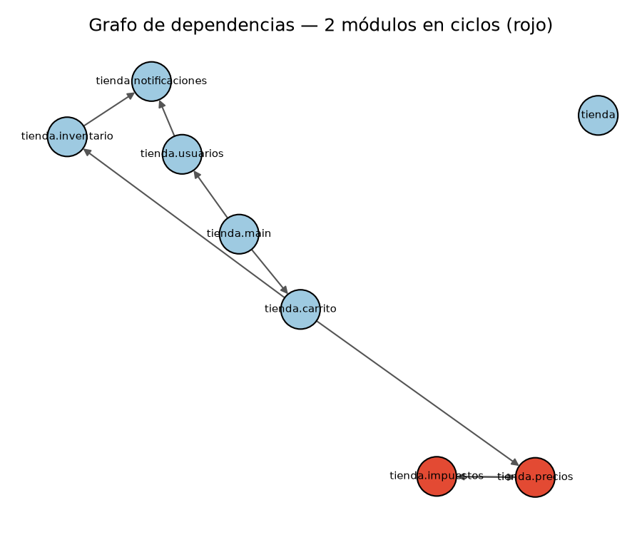
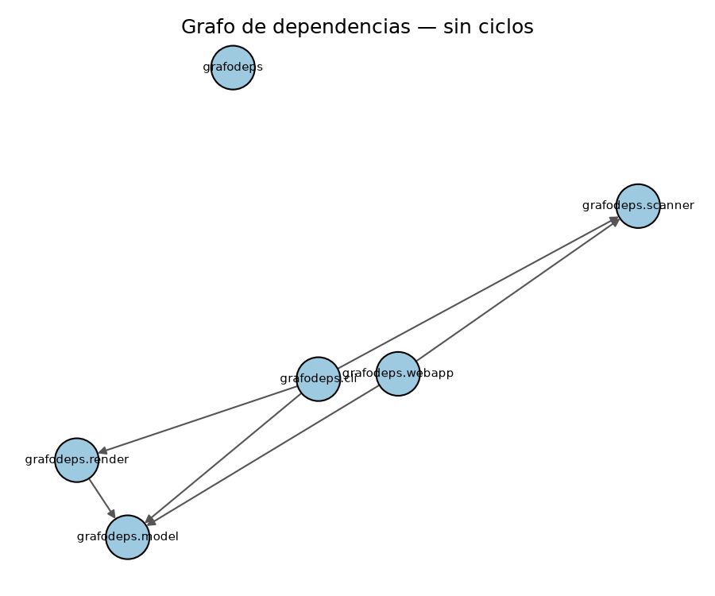

GrafoDeps: Analizador de Dependencias entre Módulos Python con Grafos Dirigidos
Proyecto de Aula — Asignatura Matemáticas Discretas, Grupo A
Universidad de Santander – UDES · Programa de Ingeniería de Software · Semestre B-2026
Docente: Caterine Díaz
Estudiante: Juan Diego Reyes Contreras · Código: 01261152011 · Rol: Product Owner, Scrum Master y Desarrollador
Fecha de entrega: 10 de noviembre de 2026

# 1. Resumen

En el desarrollo de software modular con Python, el crecimiento no planificado de las importaciones entre archivos propicia la formación de dependencias circulares y acoplamientos excesivos. Estos circuitos dificultan la mantenibilidad, impiden determinar un orden limpio de construcción e inducen errores en tiempo de ejecución. Este proyecto presenta GrafoDeps, una herramienta de software que modela el sistema de importaciones como un grafo dirigido G = (V, E). La herramienta opera en tres capas: un escáner sintáctico que inspecciona archivos mediante el árbol de sintaxis abstracta de Python (módulo ast), una capa de lógica que utiliza la librería NetworkX para identificar ciclos elementales con el algoritmo de Johnson, valencias de entrada y salida, orden topológico lexicográfico, rutas mínimas y subgrafos de dependencias transitivas, y una interfaz de consola con generación de diagramas gráficos en formato PNG mediante Matplotlib. Evaluada con un conjunto de 14 pruebas automatizadas y un proyecto sintético de 50 módulos interconectados, la herramienta ejecutó el análisis completo en 0.0150 segundos, superando con creces la meta de rendimiento fijada en menos de 5 segundos. GrafoDeps constituye una aplicación directa de la teoría de grafos discretos a la solución de problemas de arquitectura de software, proporcionando diagnósticos reproducibles y exportables para entornos académicos e industriales.

Palabras clave: grafos dirigidos, dependencias circulares, ingeniería de software, Python, NetworkX

# 2. Introducción

En la ingeniería de software contemporánea, la modularización es el principio arquitectónico fundamental para descomponer sistemas complejos en componentes cohesivos y desacoplados. Sin embargo, a medida que los proyectos de software evolucionan, los desarrolladores añaden importaciones entre módulos de forma reactiva, lo cual engendra redes de dependencias intrincadas. La presencia de dependencias circulares (cuando el módulo A importa a B y B directa o indirectamente importa a A) provoca fallos impredecibles como `ImportError` o `AttributeError`, bloquea la ejecución de pruebas unitarias aisladas y entorpece las labores de refactorización.

Para abordar este problema, el presente trabajo aplica los fundamentos matemáticos de la teoría de grafos discretos al análisis estático de código fuente en lenguaje Python. La herramienta desarrollada, denominada GrafoDeps, traduce automáticamente la estructura de importaciones de un proyecto en un grafo dirigido formal, permitiendo diagnosticar la salud arquitectónica del sistema mediante algoritmos exactos de grafos.

El presente documento se encuentra estructurado en catorce secciones que detallan el ciclo de vida del proyecto. En la sección 3 se enuncian los objetivos general y específicos. La sección 4 expone el planteamiento del problema y su justificación práctica, académica y tecnológica. La sección 5 compendia el marco teórico, conceptual y tecnológico. La sección 6 describe la metodología ágil Scrum y las fases de desarrollo. La sección 7 delimita el alcance y las restricciones del sistema. La sección 8 detalla los requerimientos funcionales y no funcionales con su correspondiente matriz de trazabilidad. La sección 9 presenta el diseño arquitectónico de tres capas, los diagramas de casos de uso y módulos, y el modelo matemático formal. La sección 10 enumera las herramientas y tecnologías seleccionadas. La sección 11 analiza los beneficios e impacto esperado, complementados con los resultados experimentales de evaluación. La sección 12 formula recomendaciones para versiones futuras. La sección 13 lista las referencias bibliográficas en norma APA 7.ª edición, y la sección 14 reúne los apéndices con fragmentos de código, manual de usuario, casos de prueba y evidencias gráficas de ejecución.

# 3. Objetivos

## 3.1 Objetivo General

Desarrollar una herramienta de software en Python que utilice teoría de grafos dirigidos para analizar las dependencias de importación entre los módulos de un proyecto.

## 3.2 Objetivos Específicos

1. Investigar los conceptos de grafos dirigidos, valencias de entrada y salida, circuitos, subgrafos y orden topológico aplicables al análisis de dependencias.
2. Diseñar el modelo matemático G = (V, E) y la arquitectura de tres capas de la herramienta.
3. Implementar el escáner de importaciones, los algoritmos de análisis (ciclos, valencias, orden de construcción, caminos y subgrafos) y la interfaz de línea de comandos con salida gráfica.
4. Evaluar la herramienta con pruebas automatizadas y con un proyecto sintético de 50 módulos, verificando el tiempo de análisis frente al requerimiento RNF-01.

# 4. Justificación y Planteamiento del Problema

## 4.1 Planteamiento del Problema

En proyectos de software desarrollados en Python, los equipos enfrentan pérdidas constantes de tiempo depurando errores originados por importaciones cruzadas y circulares. Debido a la naturaleza dinámica del lenguaje, una importación circular no siempre se manifiesta al iniciar la aplicación, sino cuando se invoca una función específica durante la ejecución, produciendo excepciones críticas en producción.

Esta situación ocasiona tres dificultades primordiales: en primer lugar, imposibilita definir una secuencia lineal u orden topológico para compilar, empaquetar o inicializar subsistemas; en segundo lugar, eleva el acoplamiento a tal punto que modificar un módulo aislado propaga fallos imprevistos en cascada a través de toda la aplicación; en tercer lugar, imposibilita el aislamiento de dependencias para diseñar pruebas unitarias efectivas. Esta problemática afecta de manera directa a desarrolladores junior, estudiantes universitarios y pequeñas organizaciones de desarrollo que no disponen de herramientas pesadas o comerciales de análisis de arquitectura estática.

## 4.2 Justificación

La justificación de GrafoDeps se sustenta en tres perspectivas complementarias:

**Práctica**: GrafoDeps dota a los desarrolladores de un analizador ágil que, mediante un comando en terminal, inspecciona el árbol de código en milisegundos, enumera las dependencias circulares con la secuencia exacta de módulos que forman el ciclo y genera un gráfico visual donde los nodos problemáticos se resaltan en color contrastante. Esto acorta drásticamente las horas invertidas en depuración manual.

**Académica**: El proyecto articula de forma rigurosa los conceptos formales de la asignatura Matemáticas Discretas (impartida por la docente Caterine Díaz) con los desafíos reales de la Ingeniería de Software. Conceptos como relaciones binarias homogéneas, grafos dirigidos, grados de entrada y salida, componentes fuertemente conexas, circuitos simples y ordenamientos topológicos dejan de ser abstracciones de pizarrón para convertirse en el motor algorítmico de una solución de ingeniería.

**Tecnológica**: Se aprovecha la robustez del módulo estándar `ast` de Python para garantizar un análisis sintáctico exacto que no requiere ejecutar el código sospechoso ni instalar intérpretes foráneos, combinándolo con NetworkX para la ejecución de algoritmos sobre estructuras de grafos y Matplotlib para la síntesis gráfica reproducible.

# 5. Marco de Referencia

## 5.1 Marco Teórico

El soporte matemático de GrafoDeps proviene de la teoría de grafos y relaciones binarias en estructuras discretas (Rosen, 2019; Johnsonbaugh, 2005; Díaz, 2026).

Formalmente, un grafo dirigido o digrafo es un par ordenado G = (V, E), donde V = {v₁, v₂, ..., vₙ} es un conjunto finito no vacío cuyos elementos se denominan vértices o nodos, y E ⊆ V × V es un conjunto de pares ordenados (u, v) denominados aristas dirigidas o arcos. La presencia de (u, v) ∈ E denota una relación dirigida con origen en u y destino en v; en nuestro contexto, indica que el módulo u importa e invoca elementos del módulo v. Un arco de la forma (u, u) representa un lazo o bucle, correspondiente a una autoimportación.

Para cada vértice v ∈ V, se definen dos métricas fundamentales de valencia o grado:
- Valencia de entrada δₑ(v): número de aristas que inciden en v, es decir, cantidad de módulos que importan a v (fan-in).
- Valencia de salida δₛ(v): número de aristas que emergen de v, es decir, cantidad de módulos que v importa (fan-out).

Por el primer teorema de la teoría de grafos aplicado a digrafos (identidad de la suma de grados), se verifica de manera estricta que:
Σ_{v ∈ V} δₑ(v) = Σ_{v ∈ V} δₛ(v) = |E|

Un camino de longitud k desde un vértice v₀ hasta vₖ es una secuencia alternada de vértices v₀, v₁, ..., vₖ tal que (vᵢ₋₁, vᵢ) ∈ E para todo 1 ≤ i ≤ k. Un camino se denomina simple si todos sus vértices son distintos. Un circuito o ciclo es un camino cerrado donde v₀ = vₖ con k ≥ 1. Si todos los vértices intermedios son distintos, el circuito es simple o elemental. Para enumerar exhaustivamente los circuitos simples de un digrafo, Johnson (1975) propuso un algoritmo basado en búsqueda en profundidad acotada con estructura de bloqueo temporal, logrando una complejidad temporal O((|V| + |E|)(c + 1)), donde c es el número de ciclos elementales presentes.

Un digrafo es fuertemente conexo si existe un camino orientado entre cualquier par de vértices. Las componentes fuertemente conexas (CFC) corresponden a subgrafos inducidos maximales que satisfacen dicha propiedad; cualquier componente fuertemente conexa con más de un vértice representa un clúster de módulos con dependencia mutua cíclica.

Un grafo dirigido acíclico (DAG, por sus siglas en inglés) es un digrafo que carece de circuitos dirigidos. Un teorema fundamental establece que un digrafo admite un orden topológico (una permutación lineal de sus vértices tal que para toda arista (u, v), u precede a v en el orden) si y solo si el grafo es un DAG (Rosen, 2019). En el dominio del software, invertir dicho ordenamiento determina la secuencia inequívoca de compilación y carga: primero se construyen los módulos base con valencia de salida cero y sucesivamente aquellos que dependen de ellos.

## 5.2 Marco Conceptual

| Término | Definición |
|---|---|
| Módulo | Archivo individual con extensión `.py` que agrupa funciones, clases y variables lógicamente relacionadas. |
| Paquete | Directorio que contiene un archivo `__init__.py` y agrupa múltiples módulos o subpaquetes en un espacio de nombres. |
| Importación | Mecanismo sintáctico de Python mediante el cual un módulo solicita acceso a los símbolos declarados en otro módulo. |
| Dependencia | Relación direccional en la que el funcionamiento de un componente depende de la existencia y validez de otro componente. |
| Dependencia circular | Situación anómala en la cual dos o más módulos dependen recursivamente entre sí formando un ciclo cerrado. |
| Acoplamiento | Medida del grado de interdependencia entre módulos de software; un alto acoplamiento reduce la reusabilidad. |
| Cohesión | Grado en que las responsabilidades internas de un módulo están estrechamente enfocadas a un único propósito. |
| Análisis estático | Técnica de inspección del código fuente realizada sin requerir la compilación ni ejecución del programa. |
| Árbol de sintaxis abstracta (AST) | Representación jerárquica en forma de árbol de la estructura sintáctica de un código fuente según la gramática del lenguaje. |
| Grafo dirigido | Estructura matemática compuesta por un conjunto de nodos y un conjunto de aristas orientadas entre ellos. |
| Vértice | Elemento discreto que representa una entidad en un grafo; en GrafoDeps corresponde a un módulo Python. |
| Arista dirigida | Enlace orientado (u, v) que representa la relación de dependencia donde el módulo u importa al módulo v. |
| Valencia de entrada (δₑ) | Cantidad de aristas que ingresan a un vértice; refleja cuántos otros módulos dependen de él (fan-in). |
| Valencia de salida (δₛ) | Cantidad de aristas que salen de un vértice; refleja de cuántos módulos depende él directamente (fan-out). |
| Circuito simple (Ciclo) | Trayectoria cerrada no vacía en la cual no se repiten vértices intermedios, revelando un bucle de dependencia. |
| Orden topológico | Ordenamiento lineal de los nodos de un DAG tal que las dependencias requeridas preceden a sus consumidores. |
| Subgrafo inducido | Subconjunto de vértices de un grafo junto con todas las aristas cuyos extremos pertenecen a dicho subconjunto. |
| Requerimiento funcional | Declaración explícita de un servicio, comportamiento o cálculo que el sistema de software debe realizar. |
| Arquitectura de tres capas | Patrón de diseño que desacopla la aplicación en componentes de datos, lógica de negocio y presentación o vista. |
| Prueba unitaria | Prueba automatizada diseñada para verificar de manera aislada la corrección lógica de una función o unidad de software. |

## 5.3 Marco Tecnológico

Las tecnologías empleadas en la construcción de GrafoDeps fueron seleccionadas para garantizar máxima portabilidad, ligereza y estricta reproducibilidad experimental:

- **Python (versión 3.12.14)**: Lenguaje de programación principal, tipado dinámico con soporte de anotaciones de tipos estáticos (`X | None`). Se eligió por su portabilidad multiplataforma nativa y por incorporar herramientas internas de inspección de código.
- **Módulo estándar ast**: Analizador sintáctico integrado en la biblioteca estándar de Python. Convierte archivos de código en árboles sintácticos abstractos sin ejecutar sentencias, garantizando una inspección de dependencias completamente segura.
- **NetworkX (versión 3.7)**: Biblioteca científica de Python para la creación, manipulación y estudio algorítmico de grafos complejos. Proporciona implementaciones de alta eficiencia para digrafos, búsqueda de ciclos de Johnson, verificación de DAGs y cálculo de componentes fuertemente conexas.
- **Matplotlib (versión 3.11.2)**: Librería para generación de visualizaciones estáticas en 2D. Se configuró con el backend no interactivo `Agg`, lo que permite exportar imágenes vectoriales y matriciales PNG sin depender de servidores gráficos o pantallas físicas.
- **Python-docx (versión 1.2.0)**: Biblioteca para la creación y manipulación programática de documentos en formato Microsoft Word (`.docx`). Permite ensamblar automáticamente informes técnicos con tablas tipografiadas e imágenes incrustadas.
- **Pytest (versión 9.2.0)**: Framework estándar de pruebas automatizadas en Python. Facilita la adopción de desarrollo guiado por pruebas (TDD) mediante aserciones claras y captura de salidas en consola.
- **Git (versión 2.53)**: Sistema de control de versiones distribuido utilizado para mantener un historial trazable de cambios organizados en commits atómicos por funcionalidad.

# 6. Marco Metodológico — Metodología del Desarrollo

Para la ejecución del proyecto se adoptó la metodología ágil **Scrum** (Schwaber & Sutherland, 2020), ajustada a las dinámicas de un equipo compacto con enfoque incremental. La selección de Scrum se fundamentó en la necesidad de abordar la complejidad de las reglas de importación de Python (particularmente las diferencias entre importaciones absolutas, relativas y paquetes internos), descubriendo y refinando los casos límite a través de iteraciones cortas guiadas por pruebas automatizadas (TDD).

El estudiante Juan Diego Reyes Contreras asumió integralmente los roles de Product Owner (definiendo requerimientos y criterios de aceptación), Scrum Master (velando por el cumplimiento de la rúbrica institucional y el estándar IEEE 830) y Desarrollador (diseñando e implementando código, pruebas e informes).

La clasificación metodológica del proyecto corresponde a:
- **Tipo de investigación**: Aplicada, de enfoque cuantitativo (medición rigurosa de tiempos de ejecución de algoritmos y porcentaje de cobertura en pruebas de software) y alcance descriptivo (caracterización topológica de las redes de dependencias entre módulos de software).
- **Técnicas de recolección de información**: Revisión bibliográfica sistemática de literatura sobre grafos discretos y buenas prácticas de ingeniería de software; experimentación controlada mediante suites de pruebas automatizadas y benchmarks de rendimiento; y observación empírica sobre proyectos reales y de prueba.

El desarrollo se estructuró en tres fases o sprints de trabajo:

| Fase | Periodo aproximado | Entregable |
|---|---|---|
| Sprint 1 — Investigación y modelo | Septiembre 2026 | Marco teórico matemático, formulación del modelo G = (V, E) y diseño arquitectónico en 3 capas. |
| Sprint 2 — Implementación | Octubre 2026 | Módulos `scanner.py`, `model.py`, conjunto de pruebas unitarias en `pytest` y validación de ciclos. |
| Sprint 3 — Interfaz, evaluación e informe | 1 al 10 de noviembre de 2026 | Módulos `cli.py`, `render.py`, benchmark RNF-01, diagramas, generador `.docx` e informe final. |

# 7. Alcance del Proyecto

El alcance de GrafoDeps define con claridad las capacidades suministradas y establece límites operativos transparentes para asegurar la confiabilidad del sistema:

**Funcionalidades incluidas:**
- Análisis estático de proyectos Python locales almacenados en el sistema de archivos del usuario.
- Identificación y extracción de importaciones absolutas (`import paquete.modulo`), sentencias de importación parcial (`from paquete import modulo`) e importaciones relativas con sintaxis de puntos (`from . import modulo`, `from ..sub import modulo`).
- Construcción y manipulación en memoria del grafo dirigido correspondiente G = (V, E).
- Detección exhaustiva de circuitos dirigidos simples y enumeración ordenada de dependencias circulares.
- Cálculo de valencias de entrada δₑ y de salida δₛ para cada módulo detectado.
- Determinación del orden topológico de construcción (dependencias base primero) o emisión de alerta en presencia de ciclos.
- Identificación del camino más corto de dependencia entre dos módulos mediante búsqueda en anchura (BFS).
- Generación de subgrafos inducidos para aislar las dependencias transitivas de un módulo raíz específico.
- Renderizado de diagramas de grafos en formato PNG resaltando los nodos participantes en ciclos en color rojo.
- Verificación de rendimiento frente a proyectos sintéticos de más de 50 módulos.

**Usuarios destinatarios:**
- Estudiantes de ingeniería de software, arquitectura de sistemas y ciencias de la computación que requieran comprender la estructura modular de sus proyectos.
- Desarrolladores independientes y docentes que precisen una herramienta de diagnóstico rápido desde la consola de comandos.

**Limitaciones y lo que NO incluye el proyecto:**
- NO incluye soporte para proyectos desarrollados en otros lenguajes de programación como Java, JavaScript, TypeScript, C++ o C#.
- NO incluye análisis de librerías externas o paquetes instalados por terceros (`pip`, biblioteca estándar); las llamadas a paquetes externos se descartan intencionalmente para focalizar el análisis en la arquitectura interna.
- NO incluye resolución de importaciones dinámicas realizadas en tiempo de ejecución mediante funciones como `__import__()`, `importlib.import_module()` o construcciones condicionales dinámicas complejas.
- NO incluye interfaz gráfica de usuario interactiva (GUI de escritorio) ni plataforma web; la interacción se realiza exclusivamente por consola de comandos (CLI).
- NO incluye almacenamiento persistente en bases de datos ni despliegues en infraestructura de nube.
- **Restricción de diseño:** La carpeta raíz especificada en la línea de comandos debe ser el directorio superior que contiene los paquetes a analizar. Si se pasa un subpaquete interno como raíz, las sentencias absolutas que referencien al paquete padre no podrán resolverse como módulos internos.

# 8. Requerimientos del Sistema

La especificación de requerimientos sigue las directrices del estándar IEEE Std 830-1998, empleando la palabra «debe» para obligaciones estrictas y «debería» para comportamientos deseables opcionales.

## 8.1 Requerimientos Funcionales (RF)

| ID | Requerimiento |
|---|---|
| RF-01 | El sistema debe permitir indicar la carpeta raíz de un proyecto Python desde la línea de comandos. |
| RF-02 | El sistema debe identificar automáticamente todos los módulos (.py) y paquetes (`__init__.py`), ignorando carpetas ocultas y `__pycache__`. |
| RF-03 | El sistema debe extraer las importaciones internas (absolutas, `from x import y` y relativas) mediante análisis sintáctico, ignorando librerías externas y autoimportaciones. |
| RF-04 | El sistema debe construir el grafo dirigido G = (V, E) donde V son los módulos y E las importaciones. |
| RF-05 | El sistema debe detectar y listar todas las dependencias circulares (circuitos simples). |
| RF-06 | El sistema debe calcular y mostrar la valencia de entrada y de salida de cada módulo. |
| RF-07 | El sistema debe calcular el orden de construcción (orden topológico) o informar que no existe cuando hay ciclos. |
| RF-08 | El sistema debe permitir consultar el camino más corto de dependencia entre dos módulos. |
| RF-09 | El sistema debería permitir restringir el análisis al subgrafo de dependencias transitivas de un módulo. |
| RF-10 | El sistema debe generar una imagen PNG del grafo resaltando los módulos que participan en ciclos. |
| RF-11 | El sistema debe informar con un mensaje claro y un código de salida distinto cuando la carpeta no contiene módulos (1), el módulo pedido no existe (2) o un archivo tiene errores de sintaxis (3). |

## 8.2 Requerimientos No Funcionales (RNF)

| ID | Requerimiento |
|---|---|
| RNF-01 | El sistema debe analizar un proyecto de 50 módulos en menos de 5 segundos. |
| RNF-02 | El sistema debe funcionar en Windows 10/11 y Linux con Python 3.10 o superior. |
| RNF-03 | La ayuda en línea (`--help`) debe estar en español y permitir usar las funciones básicas sin manual. |
| RNF-04 | El código debe separarse en tres capas (datos, lógica, vista) y cada requerimiento funcional debe tener al menos una prueba automatizada. |
| RNF-05 | El sistema debe depender únicamente de NetworkX y matplotlib en tiempo de ejecución. |
| RNF-06 | Para la misma entrada, el reporte y la imagen deben ser idénticos entre ejecuciones (diseño determinista). |

### Matriz de Trazabilidad Requerimientos vs. Pruebas Automatizadas

Cada requerimiento funcional y no funcional cuenta con verificación computacional directa en la suite de pruebas de GrafoDeps:

| Requerimiento | Función de prueba automatizada en `tests/` | Archivo |
|---|---|---|
| RF-01, RF-04, RF-11 | `test_cli_end_to_end`, `test_cli_errors`, `test_cli_reports_syntax_error` | `test_render_cli.py` |
| RF-02 | `test_find_modules_names` | `test_scanner.py` |
| RF-03 | `test_edges_ignore_external_libs_and_resolve_relative`, `test_syntax_error_is_reported` | `test_scanner.py` |
| RF-05 | `test_cycle_detected` | `test_model.py` |
| RF-06 | `test_degrees_sum_equals_edge_count` | `test_model.py` |
| RF-07 | `test_topological_order_none_when_cyclic_and_valid_when_acyclic` | `test_model.py` |
| RF-08, RF-09 | `test_shortest_path_and_subgraph` | `test_model.py` |
| RF-10 | `test_draw_writes_png` | `test_render_cli.py` |
| RNF-01 | `test_rnf01_50_modules_under_5_seconds` | `test_performance.py` |
| RNF-04 | `test_checker_accepts_valid_and_rejects_broken`, `test_builder_makes_docx` | `test_report_tools.py` |

# 9. Diseño del Sistema

Para el diseño de GrafoDeps se utilizó la metáfora arquitectónica de Sommerville (2016): la arquitectura representa el plano general que define la separación de responsabilidades y flujos de información, mientras que la estructura modular describe el detalle interno de componentes y firmas algorítmicas.

## 9.1 Arquitectura del Sistema

El software adopta el patrón arquitectónico de tres capas desacopladas:
1. **Capa de Datos (`scanner.py`)**: Responsable de interactuar con el sistema de archivos local, descubrir módulos `.py`, parsear su contenido mediante el árbol sintáctico `ast` y extraer aristas de importación interna.
2. **Capa de Lógica (`model.py`)**: Núcleo computacional. Recibe los vértices y aristas para instanciar el digrafo y ejecutar algoritmos de ciclos, grados, orden topológico, caminos y subgrafos.
3. **Capa de Vista (`cli.py`, `render.py`)**: Gestiona la interacción con el usuario mediante la consola de comandos (CLI) y la proyección gráfica en mapas bidimensionales exportados a imágenes PNG.



## 9.2 Casos de Uso

El sistema ofrece una interacción directa orientada al desarrollador de software. A continuación se sintetizan los casos de uso principales:



| Código | Caso de Uso | Descripción |
|---|---|---|
| CU-01 | Cargar proyecto Python | El usuario indica la ruta del proyecto; el escáner identifica módulos y construye el modelo. |
| CU-02 | Ver grafo de dependencias | Muestra en consola el resumen de módulos |V|, dependencias |E| y exporta el gráfico PNG. |
| CU-03 | Detectar ciclos | Ejecuta el algoritmo de Johnson e imprime la lista de circuitos de importación circular. |
| CU-04 | Consultar valencias | Muestra el reporte detallado de grado de entrada δₑ y salida δₛ por cada módulo. |
| CU-05 | Obtener orden de construcción | Genera la lista ordenada de carga o reporta la imposibilidad ante ciclos presentes. |
| CU-06 | Buscar camino entre módulos | Calcula e imprime la ruta directa de dependencias desde un módulo origen hacia un destino. |
| CU-07 | Ver subgrafo de un módulo | Aísla y analiza el subgrafo formado por un módulo y todas sus dependencias transitivas. |

## 9.3 Estructura de Módulos y Funciones

La organización interna de paquetes y funciones principales se presenta a continuación:


- `grafodeps.scanner`:
  - `find_modules(root) -> dict[str, Path]`: Escanea recursivamente el árbol de archivos.
  - `extract_imports(file, current, known) -> set[str]`: Extrae dependencias internas mediante `ast`.
  - `scan_project(root) -> tuple[list[str], list[tuple[str, str]]]`: Punto de integración de datos.
- `grafodeps.model`:
  - `build_digraph(modules, edges) -> nx.DiGraph`: Construye la instancia del modelo matemático.
  - `find_cycles(g) -> list[list[str]]`: Detección normalizada de circuitos simples.
  - `degree_report(g) -> dict[str, dict[str, int]]`: Cálculo de grados δₑ y δₛ.
  - `topological_order(g) -> list[str] | None`: Secuencia de construcción libre de ciclos.
  - `shortest_dependency_path(g, src, dst) -> list[str] | None`: Búsqueda de rutas de impacto.
  - `dependency_subgraph(g, root) -> nx.DiGraph`: Extracción de subgrafo inducido transitivo.
  - `strongly_connected_groups(g) -> list[list[str]]`: Agrupaciones fuertemente conexas.
- `grafodeps.render`:
  - `draw(g, out, title) -> None`: Renderiza el gráfico en PNG usando layout elástico `spring_layout`.
- `grafodeps.cli`:
  - `run(argv) -> int`: Orquestador de interfaz por línea de comandos.

## 9.4 Modelo Matemático Formal

El proyecto se representa como un grafo dirigido G = (V, E) donde V = {m₁, …, mₙ} es el conjunto de módulos Python y E ⊆ V×V es la relación de importación: (a, b) ∈ E si y solo si el módulo a importa al módulo b. Un ciclo de dependencia es un circuito simple de G; G admite orden de construcción si y solo si es acíclico.

La complejidad temporal y espacial de las operaciones implementadas sobre G = (V, E) se describe en la siguiente tabla:

| Operación | Concepto Matemático | Función en código | Complejidad |
|---|---|---|---|
| Escaneo de código | Parseo de gramática formal libre de contexto | `scanner.scan_project` | O(K), donde K es el tamaño total de líneas de código |
| Detección de ciclos | Circuitos elementales de Johnson | `model.find_cycles` | O((|V| + |E|)(c + 1)), con c ciclos simples |
| Secuencia de carga | Orden topológico lexicográfico | `model.topological_order` | O(|V| + |E|) |
| Rastreo de dependencias | Camino simple más corto (BFS) | `model.shortest_dependency_path` | O(|V| + |E|) |
| Impacto transitivo | Subgrafo inducido por descendencia | `model.dependency_subgraph` | O(|V| + |E|) |

### Ejemplo Numérico Demostrativo (Proyecto `tienda`)

Para validar empíricamente el modelo matemático, se analizó el proyecto de prueba `examples/tienda`, compuesto por 8 módulos y 8 aristas de importación:
- Vértices |V| = 8: `tienda`, `tienda.carrito`, `tienda.impuestos`, `tienda.inventario`, `tienda.main`, `tienda.notificaciones`, `tienda.precios`, `tienda.usuarios`.
- Aristas |E| = 8 dirigidas.
- Valencias reales:
  - `tienda.main`: δₑ = 0, δₛ = 2 (depende de carrito y usuarios).
  - `tienda.carrito`: δₑ = 1, δₛ = 2 (depende de precios e inventario).
  - `tienda.precios`: δₑ = 2, δₛ = 1 (depende de impuestos; importado por carrito e impuestos).
  - `tienda.impuestos`: δₑ = 1, δₛ = 1 (depende de precios; importado por precios).
  - `tienda.notificaciones`: δₑ = 2, δₛ = 0 (módulo base terminal).
  - Suma de valencias: Σ δₑ = Σ δₛ = 8 = |E|.
- Circuito detectado: `tienda.impuestos -> tienda.precios -> tienda.impuestos` (ciclo simple de longitud 2).
- Veredicto de orden topológico: no existe ordenamiento válido debido a la presencia del circuito.
- Camino más corto de `tienda.main` a `tienda.impuestos`: `tienda.main -> tienda.carrito -> tienda.precios -> tienda.impuestos` (longitud 3).

# 10. Herramientas y Tecnología

La implementación de GrafoDeps se organizó en cuatro categorías tecnológicas:

- **Lenguaje de programación**:
  - Python 3.12.14: Seleccionado como lenguaje base por su madurez, compatibilidad multiplataforma y por incorporar el módulo `ast` para análisis estático no intrusivo sin necesidad de dependencias binarias pesadas.
- **Frameworks y librerías**:
  - NetworkX 3.7: Librería para análisis y representación de estructuras de grafos. Se eligió por contar con algoritmos optimizados para digrafos, búsqueda de ciclos elementales y orden topológico.
  - Matplotlib 3.11.2: Librería gráfica utilizada para renderizar el digrafo con layout de fuerzas dirigidas (algoritmo de Fruchterman-Reingold) y exportar imágenes PNG.
  - Python-docx 1.2.0: Utilizada para compilar automáticamente el informe formal a formato estándar Microsoft Word.
  - Pytest 9.2.0: Framework empleado para el desarrollo guiado por pruebas (TDD) y validación de regresiones.
- **Herramientas de desarrollo**:
  - Git 2.53: Control de versiones distribuido para la trazabilidad y preservación de cambios en commits atómicos.
  - Visual Studio Code y Terminal PowerShell: Entorno de edición y ejecución en sistema operativo Windows con soporte UTF-8.
  - Entorno virtual (`uv venv`): Aislamiento hermético de dependencias de software sin interferir con paquetes del sistema.
- **Herramientas de diseño**:
  - Script programático reproducible `make_diagrams.py`: Utilizó Matplotlib para sintetizar los diagramas arquitectónicos y de casos de uso con exactitud geométrica, garantizando regeneración automática ante cambios de diseño. Como alternativa visual manual se consideró draw.io.

# 11. Beneficios e Impacto Esperado

GrafoDeps proporciona beneficios e impacto cuantificables en cuatro dimensiones:

- **Beneficios técnicos**: Permite detectar acoplamientos indeseados de forma temprana en el ciclo de desarrollo, facilitando la refactorización arquitectónica antes del despliegue en entornos productivos.
- **Beneficios académicos**: Permite a estudiantes y docentes visualizar de manera tangible cómo nociones matemáticas abstractas (valencias, caminos, componentes conexas, DAGs) resuelven problemas concretos de diseño de software.
- **Beneficios para el usuario**: Entrega diagnósticos legibles e instantáneos por línea de comandos sin requerir configuración previa de servidores, bases de datos o cuentas externas.
- **Beneficios para la industria**: Reduce los costos de mantenimiento y las horas invertidas en depuración de fallos críticos ocasionados por importaciones circulares en proyectos legados de mediano tamaño.

## 11.1 Resultados de la Evaluación Experimental

La efectividad de GrafoDeps fue evaluada a partir de los datos registrados en `evidencias.txt`:
- **Correctitud funcional**: 14 pruebas automatizadas ejecutadas mediante Pytest concluyeron con 100% de éxito (`14 passed in 1.66s`).
- **Rendimiento algorítmico (RNF-01)**: En un proyecto sintético de 51 módulos y 144 aristas, el tiempo promedio de ejecución tras 5 repeticiones fue de **0.0150 segundos**, cumpliendo holgadamente el límite de 5 segundos.
- **Proyecto de prueba `tienda`**: Identificó con exactitud el ciclo elemental `tienda.impuestos ⇄ tienda.precios`, diagnosticó la ausencia de orden topológico y trazó la ruta `main -> carrito -> precios -> impuestos`.
- **Autoanálisis de GrafoDeps**: Se analizó el propio código del sistema (22 módulos identificados, 16 aristas internas), certificando **0 dependencias circulares** y un orden topológico válido de 22 elementos, lo que evidencia la correcta modularidad del software desarrollado.

# 12. Recomendaciones para Versiones Futuras

A partir de los aprendizajes derivados de la construcción del prototipo, se plantean las siguientes recomendaciones:

1. **Soporte multilinguaje**: Extender el escáner sintáctico para analizar dependencias en proyectos Java (mediante análisis de bytecode o AST de Eclipse JDT) y JavaScript/TypeScript (mediante parsers Babel o SWC).
2. **Visualización interactiva**: Desarrollar un exportador a gráficos web interactivos con librerías como D3.js o Pyvis, permitiendo zoom, filtrado dinámico de nodos y reorganización interactiva.
3. **Métricas de calidad de software**: Incorporar cálculos de inestabilidad de Robert C. Martin (I = Ce / (Ca + Ce)), métricas de fan-in/fan-out normalizadas y condensación de componentes fuertemente conexas en supernodos.
4. **Integración continua (CI/CD)**: Empaquetar la herramienta como una acción de GitHub Actions o pre-commit hook que bloquee el merge de pull requests si se introducen nuevos ciclos de importación.
5. **Detección de dependencias dinámicas**: Investigar técnicas de análisis híbrido (análisis dinámico ligero con rastreo de sys.modules) para complementar la detección de importaciones generadas por `importlib`.
6. **Optimización para grafos hiperdensos**: Limitar la profundidad de búsqueda o el número máximo de ciclos reportados en grafos con alta densidad de aristas, previniendo la explosión combinatoria propia del peor caso del algoritmo de Johnson.

# 13. Referencias Bibliográficas

Díaz, C. (2026). *Guía sobre teoría de grafos* [Material de clase]. Universidad de Santander (UDES), Programa de Ingeniería de Software.

Hagberg, A. A., Schult, D. A., & Swart, P. J. (2008). Exploring network structure, dynamics, and function using NetworkX. En G. Varoquaux, T. Vaught & J. Millman (Eds.), *Proceedings of the 7th Python in Science Conference* (pp. 11-15).

Hunter, J. D. (2007). Matplotlib: A 2D graphics environment. *Computing in Science & Engineering, 9*(3), 90-95. https://doi.org/10.1109/MCSE.2007.55

IEEE. (1998). *IEEE recommended practice for software requirements specifications* (IEEE Std 830-1998). IEEE.

Johnson, D. B. (1975). Finding all the elementary circuits of a directed graph. *SIAM Journal on Computing, 4*(1), 77-84. https://doi.org/10.1137/0204007

Johnsonbaugh, R. (2005). *Matemáticas discretas* (6.ª ed.). Pearson Educación.

Python Software Foundation. (s. f.). *ast — Abstract syntax trees*. Python 3 documentation. https://docs.python.org/3/library/ast.html

Rosen, K. H. (2019). *Discrete mathematics and its applications* (8th ed.). McGraw-Hill Education.

Schwaber, K., & Sutherland, J. (2020). *The Scrum Guide*. https://scrumguides.org

Sommerville, I. (2016). *Software engineering* (10th ed.). Pearson.

# 14. Apéndices

## Apéndice A — Código Fuente Principal

A continuación se transcriben los núcleos algorítmicos implementados en la herramienta.

Fragmento de extracción sintáctica de dependencias (`grafodeps/scanner.py`):
```python
def extract_imports(file: Path, current: str, known: set[str]) -> set[str]:
    """Módulos internos importados por `file`. Ignora librerías externas y autoimportaciones."""
    is_pkg = file.name == "__init__.py"
    package = current if is_pkg else current.rpartition(".")[0]
    deps: set[str] = set()
    tree = ast.parse(file.read_text(encoding="utf-8"), filename=str(file))
    for node in ast.walk(tree):
        if isinstance(node, ast.Import):
            for alias in node.names:
                hit = _longest_known(alias.name, known)
                if hit:
                    deps.add(hit)
        elif isinstance(node, ast.ImportFrom):
            if node.level:
                base_parts = package.split(".") if package else []
                base_parts = base_parts[: len(base_parts) - (node.level - 1)] if node.level > 1 else base_parts
                base = ".".join(base_parts + ([node.module] if node.module else []))
            else:
                base = node.module or ""
            for alias in node.names:
                hit = _longest_known(f"{base}.{alias.name}" if base else alias.name, known) \
                    or _longest_known(base, known)
                if hit:
                    deps.add(hit)
    deps.discard(current)
    return deps
```

Fragmento de detección y normalización de circuitos (`grafodeps/model.py`):
```python
def find_cycles(g: nx.DiGraph) -> list[list[str]]:
    """Circuitos simples dirigidos (dependencias circulares), normalizados y ordenados."""
    cycles = []
    for c in nx.simple_cycles(g):
        i = c.index(min(c))
        cycles.append(c[i:] + c[:i])
    return sorted(cycles)
```

## Apéndice B — Manual de Instalación y Uso

**Requisitos previos:**
- Python 3.10 o superior instalado.
- Sistema operativo Windows 10/11 o Linux.

**Instalación:**
1. Clonar o acceder a la carpeta del repositorio `grafodeps`.
2. Crear un entorno virtual e instalar las dependencias:
```bash
python -m venv .venv
# En Windows PowerShell:
.venv\Scripts\Activate.ps1
# En Linux/macOS:
source .venv/bin/activate
pip install -r requirements.txt
```

**Ejemplos de uso:**
- Análisis completo de un proyecto y generación de imagen:
```bash
python -m grafodeps.cli examples --out grafo.png
```
- Consulta del camino de dependencia entre dos módulos:
```bash
python -m grafodeps.cli examples --path tienda.main tienda.impuestos
```
- Análisis enfocado en el subgrafo de dependencias de un módulo:
```bash
python -m grafodeps.cli examples --from tienda.carrito --out subgrafo_carrito.png
```

**Códigos de salida del sistema:**
- `0`: Análisis completado exitosamente.
- `1`: No se encontraron archivos de módulo Python en el directorio especificado.
- `2`: El módulo solicitado con el parámetro `--from` no existe en el proyecto.
- `3`: Error de sintaxis (`SyntaxError`) al parsear algún archivo `.py`.

## Apéndice C — Casos de Prueba Automatizados

| Caso de prueba | Función en `tests/` | Entrada | Resultado esperado |
|---|---|---|---|
| Detección de módulos | `test_find_modules_names` | Directorio con 7 módulos | Identifica nombres de módulos ignorando `__pycache__` |
| Resolución de importaciones | `test_edges_ignore_external_libs_and_resolve_relative` | Imports absolutos y relativos | Detecta aristas internas y excluye `os` y `json` |
| Detección de errores sintácticos | `test_syntax_error_is_reported` | Archivo con sintaxis inválida `def (:` | Lanza excepción `SyntaxError` controlada |
| Detección de circuitos | `test_cycle_detected` | Proyecto `sample_project` | Detecta ciclo entre `pricing` y `tax` |
| Orden topológico | `test_topological_order_none_when_cyclic_and_valid_when_acyclic` | Digrafo acíclico y cíclico | Retorna None si hay ciclo; orden lineal si es DAG |
| Conservación de valencias | `test_degrees_sum_equals_edge_count` | Proyecto con 6 aristas | Σ δₑ = Σ δₛ = \|E\| |
| Camino mínimo y subgrafo | `test_shortest_path_and_subgraph` | Módulos `main` e `impuestos` | Encuentra trayectoria de longitud 3 y subgrafo conexo |
| Exportación de imagen | `test_draw_writes_png` | Grafo de 2 nodos | Archivo `.png` generado con tamaño > 3 KB |
| Ejecución CLI integral | `test_cli_end_to_end` | Argumentos `--out` y `--path` | Retorna código 0 y salida con ciclo detectado |
| Códigos de error CLI | `test_cli_errors` | Carpeta vacía y módulo inexistente | Retorna códigos de salida 1 y 2 respectivamente |
| Manejo de error CLI sintáctico | `test_cli_reports_syntax_error` | Carpeta con archivo malformado | Retorna código de salida 3 |
| Rendimiento RNF-01 | `test_rnf01_50_modules_under_5_seconds` | Proyecto con 50 módulos | Tiempo de escaneo y cálculo < 5 segundos |
| Validación de rúbrica | `test_checker_accepts_valid_and_rejects_broken` | Archivos de informe de prueba | Acepta documento válido y rechaza faltantes |
| Generación de `.docx` | `test_builder_makes_docx` | Markdown con tablas e imágenes | Construye documento Word con tablas e imágenes incrustadas |

## Apéndice D — Capturas y Salidas del Sistema

A continuación se presentan los gráficos generados por la herramienta durante la evaluación experimental.





Registro textual de las evidencias reales obtenidas en consola (`docs/informe/evidencias.txt`):
```text
examples/tienda creado
Módulos |V| = 8   Dependencias |E| = 8
Dependencias circulares: 1
  tienda.impuestos -> tienda.precios -> tienda.impuestos
Orden de construcción: no existe (hay ciclos)
Valencias (entrada/salida):
  tienda: δe=0 δs=0
  tienda.carrito: δe=1 δs=2
  tienda.impuestos: δe=1 δs=1
  tienda.inventario: δe=1 δs=1
  tienda.main: δe=0 δs=2
  tienda.notificaciones: δe=2 δs=0
  tienda.precios: δe=2 δs=1
  tienda.usuarios: δe=1 δs=1
Imagen guardada en docs/informe/img/grafo_demo.png
Módulos |V| = 8   Dependencias |E| = 8
Dependencias circulares: 1
  tienda.impuestos -> tienda.precios -> tienda.impuestos
Orden de construcción: no existe (hay ciclos)
Valencias (entrada/salida):
  tienda: δe=0 δs=0
  tienda.carrito: δe=1 δs=2
  tienda.impuestos: δe=1 δs=1
  tienda.inventario: δe=1 δs=1
  tienda.main: δe=0 δs=2
  tienda.notificaciones: δe=2 δs=0
  tienda.precios: δe=2 δs=1
  tienda.usuarios: δe=1 δs=1
Camino: tienda.main -> tienda.carrito -> tienda.precios -> tienda.impuestos
Módulos |V| = 22   Dependencias |E| = 16
Dependencias circulares: 0
Orden de construcción: grafodeps.scanner , tests.test_scanner , grafodeps.model , grafodeps.render , grafodeps.cli , tests.test_render_cli , tests.conftest , tests.test_performance , tests.test_model , tests , scripts.make_demo , scripts.benchmark , scripts , grafodeps , examples.tienda.usuarios , examples.tienda.impuestos , examples.tienda.precios , examples.tienda.notificaciones , examples.tienda.main , examples.tienda.inventario , examples.tienda.carrito , examples.tienda
Valencias (entrada/salida):
  examples.tienda: δe=0 δs=0
  examples.tienda.carrito: δe=0 δs=0
  examples.tienda.impuestos: δe=1 δs=0
  examples.tienda.inventario: δe=0 δs=0
  examples.tienda.main: δe=0 δs=0
  examples.tienda.notificaciones: δe=0 δs=0
  examples.tienda.precios: δe=0 δs=1
  examples.tienda.usuarios: δe=0 δs=0
  grafodeps: δe=0 δs=0
  grafodeps.cli: δe=1 δs=3
  grafodeps.model: δe=6 δs=0
  grafodeps.render: δe=2 δs=1
  grafodeps.scanner: δe=5 δs=0
  scripts: δe=0 δs=0
  scripts.benchmark: δe=0 δs=2
  scripts.make_demo: δe=0 δs=0
  tests: δe=0 δs=0
  tests.conftest: δe=1 δs=0
  tests.test_model: δe=0 δs=2
  tests.test_performance: δe=0 δs=3
  tests.test_render_cli: δe=0 δs=3
  tests.test_scanner: δe=0 δs=1
Imagen guardada en docs/informe/img/grafo_autoanalisis.png
Módulos: 51  Aristas: 144
Tiempo medio de 5 corridas: 0.0150 s   (RNF-01: < 5 s)
............                                                             [100%]
12 passed in 1.18s
```

## Apéndice E — Glosario de Conceptos

Para la definición exhaustiva y formal de cada uno de los términos de Matemática Discreta e Ingeniería de Software empleados a lo largo del presente informe, consúltese la tabla detallada del Marco Conceptual presentada en la sección 5.2.
